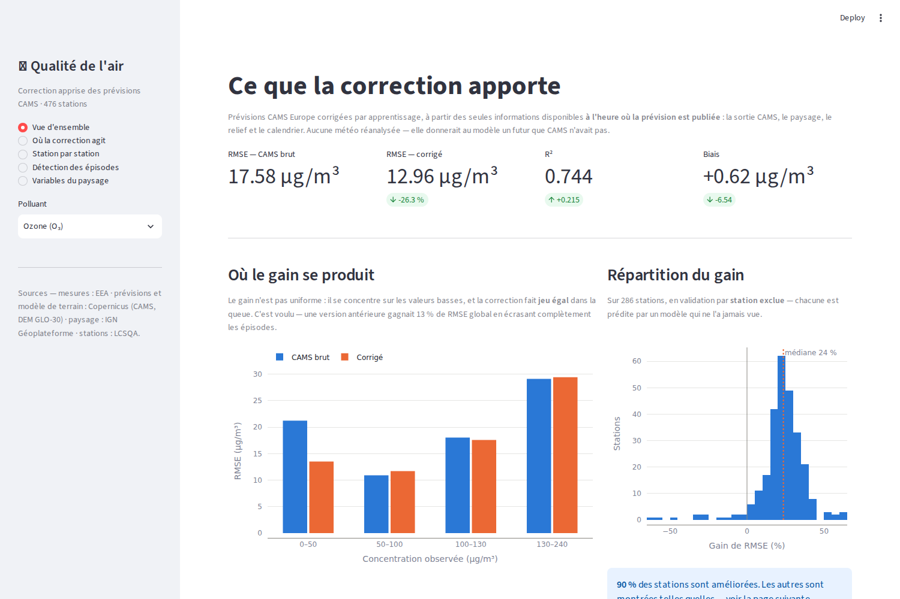
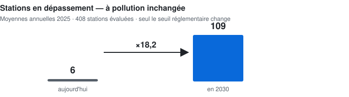

# Correction statistique des prévisions de qualité de l'air

Post-traitement des prévisions **CAMS Europe** aux stations de mesure françaises. Le modèle
apprend la **correction** `observation − CAMS`, puis l'**ajoute** à la prévision CAMS.
**Tous les résultats de ce document sont à l'échéance J+1** — les heures 25-48 d'une sortie
00 UTC, ce que le code nomme `horizon=2`. Les heures 1-24 (`horizon=1`) sont J0, et servent
de comparaison là où c'est écrit.

Corpus : **36 mois** (2023-08 → 2026-07), **28,0 M d'enregistrements horaires**, observations réglementaires
LCSQA, cible journalière. Prévisions extraites à 476 points ; **438 stations effectivement
évaluées**, de 236 (PM2,5) à 344 (NO₂) selon le polluant.

---


## Aperçu de la démonstration



L'interface s'appuie sur des artefacts de démonstration **générés localement et non
versionnés** : les captures montrent le rendu, tandis que les chiffres de ce document se
régénèrent par les scripts nommés plus bas. `streamlit run app.py` suppose donc d'avoir
d'abord reconstruit `data/demo/` — la commande seule ne suffit pas, et le dire évite une
promesse que le clone ne tient pas.

## Le résultat, et sa réserve

Évaluation avec **station et mois cachés simultanément** — la condition de déploiement :
une station nouvelle, une date future.

Échéance **J+1**, les trois polluants au même horizon.

| polluant | CAMS brut | biais glissant 7 j *(sans apprentissage)* | modèle complet |
|---|---|---|---|
| NO₂ | référence | **+42,88 %** | +44,28 % |
| PM10 | référence | **+18,63 %** | +23,63 % |
| O₃ | référence | **+16,09 %** | +20,52 % |

*Régénérable : `python3 scripts/isoler_persistance.py --polluant <P> --horizon 2`.*

### La pile complète, en double aveugle

Le tableau ci-dessus isole ce que l'apprentissage ajoute à une moyenne glissante. Celui-ci
donne ce que vaut la méthode **entière** — tous les leviers empilés — à J+1, sur 24 mois de
support commun et une pile identique aux quatre polluants :

| polluant | PARTOUT *(aucune observation du point)* | aux stations *(avec son historique)* |
|---|---|---|
| **NO₂** | **+39,6 %** | +45,7 % |
| **PM10** | **+20,2 %** | +26,3 % |
| **O₃** | **+17,9 %** | +24,1 % |
| **PM2,5** | **+11,8 %** | +19,6 % |

**Citer deux chiffres, jamais un.** Le périmètre `PARTOUT` vaut là où aucune station
n'existe — c'est celui de la spatialisation, et le seul que CAMS ne sait pas faire. L'autre
exige l'historique du point.

L'apport du dernier étage — sept traceurs de **composition** du champ CAMS, que le dépôt ne
téléchargeait pas — est le premier de ce projet à être publié **avec son intervalle** :
NO₂ +1,5 % [+0,9 ; +2,2] · O₃ +5,9 % [+3,4 ; +8,3] · PM10 +6,0 % [+4,2 ; +7,6] ·
PM2,5 +4,3 % [+2,4 ; +6,5]. Bornes basses toutes positives, même verdict sous blocs de
trois et six mois, Holm franchi — seuils fixés avant lecture.

**Le nombre de décimales suit l'intervalle**, pas l'inverse.

**Le résultat le plus important de ce dépôt n'est pas le score du modèle.** C'est que
l'essentiel de l'erreur corrigeable de CAMS aux stations est un **biais local persistant**,
qu'une moyenne glissante du résidu sur sept jours récupère sans modèle, sans
réentraînement et sans maintenance. Le modèle appris ajoute **2,7 à 5,7 points** au-delà.

Et ce n'est pas de la persistance : répéter l'observation de l'avant-veille est **pire que
CAMS** sur l'ozone (−42,5 %) et les PM10 (−22,5 %).

### Rectifications qui ont changé le verdict

> **État au 18 août 2026.** Les mesures principales ont été **refaites** après qu'une revue
> externe eut trouvé un défaut de support : quand une famille de prédicteurs manque sur un
> mois entier, le modèle apprend « absente » = « nous sommes en ce mois-là », et le
> protocole cache justement les mois. Trois familles étaient concernées. La pile publiée est
> désormais **identique pour les quatre polluants**, sur un support vérifié sans mois troué.
>
> **Le dossier a pour la première fois un intervalle** sur son épreuve principale — bootstrap
> circulaire par blocs de mois sur les différences appariées pli à pli, parce que les plis ne
> sont pas indépendants : les groupes de stations tournent et deux plis partagent 93 % de
> leur apprentissage.
>
> **Et une affirmation de ce dépôt a été réfutée par sa propre mesure.** Nous écrivions que
> les leviers ne se dégradent pas avec l'échéance. Poussé jusqu'à **J+3**, c'est vrai sur le
> NO₂ (0,38 point de plage) et **faux sur l'ozone** (−2,25 points). Le classement suit le
> mécanisme invoqué : le polluant dont le résidu est attaché au **site** résiste, celui qui
> ne l'est pas se dégrade.
>
> ⚠️ **Une erreur d'étiquette corrigée, qui nous flattait** : l'échéance publiée était J+2
> alors que la mesure est **J+1**. `horizon=2` couvre les heures 25-48 d'une sortie 00 UTC.
> Vérifié dans les données — le premier jour couvert passe du 1ᵉʳ au 2 août selon l'horizon.

---

### Ce que ce dépôt ne démontre pas

- **Aucun gain de détection d'épisode** sur l'axe déployable : ×1,18 sur PM10 au seuil de
  50 µg/m³, intervalle de confiance contenant zéro. L'avantage est significatif quand le
  mois est connu (×1,82), pas quand il est caché.
- **La supériorité sur la chaîne opérationnelle n'est mesurée que sur dix-sept jours.**
  Le résultat est réel et favorable — voir « Contre la chaîne en service » ci-dessus — mais
  PREV'AIR n'expose que six jours glissants : l'archive ne peut pas remonter le temps.
- Au seuil réglementaire ozone de 180 µg/m³, **3 dépassements détectés sur 32**.

Ces limites sont documentées au même titre que les résultats favorables — voir
`reports/`.

---

## Contre la chaîne en service — PREV'AIR

La référence honnête n'est pas CAMS brut : c'est le produit **réellement diffusé** en France.
Le fichier archivé de PREV'AIR porte dans sa métadonnée `CHIMERE combined to surface real time
observations` — c'est **AS-CHI**, leur adaptation statistique, à **1,7 km**, avec assimilation et
krigeage. Nous corrigeons un ensemble européen à **10 km**.

Mêmes stations, mêmes jours, échéance **J+1**, du **2026-07-28** au **2026-08-20** — **22 jours**.

**RMSE en µg/m³**, plus bas est meilleur :

| polluant | grain | stations | CAMS brut | **PREV'AIR** | **nous** | leur RMSE dépasse la nôtre de |
|---|---|---:|---:|---:|---:|---:|
| **NO₂** | max horaire | 318 | 23.70 | **20.88** | **12.91** | **+61.8 %** |
| **O₃** | max horaire | 257 | 25.81 | **24.49** | **21.43** | **+14.3 %** |
| **PM10** | moyenne jour | 295 | 8.36 | **8.36** | **5.46** | **+53.1 %** |
| **PM2,5** | moyenne jour | 225 | 3.54 | **4.93** | **3.21** | **+53.9 %** |

**La colonne d'écart se lit dans un seul sens** — de combien *leur* RMSE dépasse la nôtre.
Rapportée à la leur, la même réduction s'écrirait autrement : un pourcentage de comparaison sans
son dénominateur est indéfendable.

**Le biais est le second écart, et il parle davantage** : sur le NO₂, PREV'AIR sous-estime de
**-11.1 µg/m³** là où nous sommes à **-3.1**.

### La base appariée, pour que ce tableau soit vérifiable

`reports/comparaison_prevair/` porte les valeurs **alignées** — une ligne par station et par jour,
les quatre colonnes `observe`, `cams`, `prevair`, `corrige` côte à côte, avec la commune, la
position et la typologie. Soit **23 554 lignes** sur les quatre polluants.

> Une AASQA peut ainsi refaire le calcul **sur son propre périmètre** — ses départements, ses
> typologies, ses seuils — au lieu de croire le nôtre. C'est la différence entre un score qu'on
> lit et un score qu'on vérifie.

> ⚠️ **Ce que ces chiffres ne disent pas.** PREV'AIR n'expose que **six jours glissants** :
> l'archive s'est constituée jour après jour et ne peut pas remonter le temps.
> **22 jours ne concluent pas** — c'est un ordre de grandeur, mesuré à armes égales sur la
> période disponible. Et les deux systèmes connaissent leurs stations : les nôtres par
> l'entraînement, les leurs par le krigeage.

Régénérable : `python3 scripts/archiver_prevair.py` (quotidien, sinon le jour est perdu) puis
`python3 scripts/duel_prevair.py --polluant <P> --horizon 2`.

---

## L'horizon réglementaire — pourquoi ce travail a un usage, et pas seulement un score

La directive **(UE) 2024/2881** fait deux choses que l'on cite toujours séparément. Elle
**divise par deux** les valeurs limites annuelles au 1ᵉʳ janvier 2030 — NO₂ et PM10 de 40 à
**20 µg/m³**, PM2,5 de 25 à **10**. Et elle rend la **modélisation obligatoire** dans toute
zone où un seuil est dépassé. Transposition au plus tard le **11 décembre 2026**.

<picture>
  <source media="(prefers-color-scheme: dark)" srcset="reports/figures/portefeuille/v4_seuil_2030_sombre.svg">
  
</picture>

Multipliées, elles donnent l'argument que ni l'une ni l'autre ne porte seule : abaisser le
seuil **multiplie mécaniquement** le nombre de zones où modéliser devient une obligation
légale.

**Compté sur le parc réel**, moyennes annuelles 2025, taux de saisie ≥ 75 % :

| polluant | VL en vigueur | VL 2030 | évaluées | > en vigueur | > 2030 | basculent |
|---|---|---|---|---|---|---|
| NO₂ | 40 µg/m³ | **20** | 341 | 5 | **57** | +52 |
| PM10 | 40 µg/m³ | **20** | 322 | 1 | **37** | +36 |
| PM2,5 | 25 µg/m³ | **10** | 243 | 0 | **57** | +57 |

En union sur les trois polluants : **6 stations en dépassement aujourd'hui, 109 en 2030** —
un facteur **×18,2** sur 408 évaluées, **sans qu'un gramme de plus ait été émis**. Ce n'est
pas un pronostic : les émissions baisseront d'ici là. C'est la mesure d'une chose et d'une
seule, l'effet du changement de seuil **à air constant**.

### Là où le modèle devient opposable, sa qualité devient un point de contrôle

C'est le critère **FAIRMODE** qui en décide. Part des stations satisfaisant `MQI_f ≤ 1` à
l'échéance **J+1** — le critère est atteint à partir de **90 %** :

| polluant | stations | CAMS brut | corrigé · `PARTOUT` | corrigé · aux stations |
|---|---|---|---|---|
| **NO₂** | 338 | **41,4 %** ✗ | 87,9 % ✗ | **96,2 %** ✓ |
| PM10 | 304 | 87,8 % ✗ | 98,4 % ✓ | **100 %** ✓ |
| O₃ | 265 | 93,6 % ✓ | 97,4 % ✓ | **99,2 %** ✓ |

**Le NO₂ est le cas critique, et ce n'est pas une coïncidence** : c'est à la fois le polluant
où le produit européen brut échoue le plus, et celui dont la valeur limite est divisée par
deux. Son biais passe de **−14,27** à **−0,43 µg/m³**.

🔴 **Et le critère n'est pas franchi partout.** Dans la condition de déploiement — aucune
observation du point — le NO₂ atteint **87,9 %**, *sous* la barre des 90 %. Il ne la franchit
qu'aux stations instrumentées. **Citer les deux chiffres, jamais un.**

⚠️ **Deux indicateurs FAIRMODE portent le même sigle.** Ce tableau publie le `MQI_f`, critère
de **prévision**, qui rapporte l'erreur du modèle à celle d'une **persistance**. Le MQI
d'**évaluation** (`RMSE / (β·RMS_U)`, β = 2) répond à une autre question — il est en § 5 de
`reports/VERITE_DOSSIER.md`, à l'échéance J0.

### L'angle mort que la mesure ne peut pas couvrir

En Occitanie, 2 stations en dépassement aujourd'hui, **5 en 2030**, sur 25 évaluées. Et
**4 des 13 départements n'ont aucune station retenue** (09, 11, 46, 48) : pour eux, la
conformité 2030 **ne peut pas être posée depuis la mesure**. C'est exactement le cas que la
directive confie à la modélisation.

*Régénérable : `python3 scripts/seuils_2030.py`, `python3 scripts/banc_lcsqa.py`,
`python3 scripts/page_horizon_2030.py`. Chiffres gelés en § 5, 5 bis et 5 ter de
`reports/VERITE_DOSSIER.md`, régénéré par `scripts/verite_dossier.py`.*

---

<details>
<summary><strong>Installer, vérifier, reproduire</strong> — et le protocole d'évaluation en détail</summary>

## Les valeurs prédites, pas seulement les scores

Un pourcentage dit *combien* le système gagne ; il ne dit pas *ce qu'il prédit*. La matrice
`reports/matrice_predictions_2026/` porte les valeurs elles-mêmes — **station par station,
heure par heure, sur 2026** :

| | |
|---|---|
| `observe` | la mesure de référence |
| `cams` | la prévision européenne brute, telle que reçue |
| **`corrige`** | **notre sortie**, celle qu'on propose d'utiliser |

Avec le nom de la commune, la position, la typologie et l'échéance de chaque point. Les
trois colonnes côte à côte suffisent à recalculer RMSE, biais, corrélation, taux de
dépassement — **ou votre propre critère**, sans nous croire sur parole, et à regarder les cas
où la correction échoue autant que ceux où elle réussit.

⚠️ **Ces valeurs viennent du protocole *spatial* et du modèle de base** — station cachée, mois connu, sans les leviers de la pile complète. Le `resume.csv` y annonce donc **+19,2 %** sur le NO₂ là où l'épreuve principale du dossier donne +39,6 % : deux épreuves, deux chiffres, tous deux justes. Le README de la matrice détaille lequel répond à quoi.

Format Parquet, un fichier par polluant, plus un extrait CSV lisible sans outil.
**Pas besoin de cloner** : GitLab sert chaque fichier séparément. La comparaison à PREV'AIR
est publiée de la même façon dans [`reports/comparaison_prevair/`](reports/comparaison_prevair/README.md) — **23 554 lignes appariées, quatre systèmes côte à côte. Le détail des colonnes et
des réserves est dans le [README de la matrice](reports/matrice_predictions_2026/README.md).

---

## Installation

```bash
python3 -m venv .venv && source .venv/bin/activate

pip install -e ".[dev]"                # socle + tests
pip install -r requirements-lock.txt   # ou : les versions exactes du 03/08/2026
pip install -e ".[dev,grib,demo]"      # + décodage GRIB et démonstration
```

`cfgrib` est optionnel car il dépend de la bibliothèque système `eccodes`. Il n'est requis
que par les scripts d'ingestion IFS.

## Vérifier l'installation

```bash
pytest -q     # ~17 s, sans réseau
```

**Depuis un clone frais : 273 passent, 9 sont sautés.** Les neuf sautés sont les contrôles
d'ingestion de `test_stations.py`, qui ont besoin des données brutes — ils s'annoncent
« Dataset absent, lancer l'ingestion » plutôt que d'échouer. Les 273 autres tournent sur des
fixtures et ne demandent ni réseau ni téléchargement.

*Vérifié le 03/08/2026 par clone, installation et exécution dans un environnement vierge.*

## Trois commandes qui produisent les résultats du tableau

```bash
# 1. Prédictions hors pli des trois épreuves + diagnostic de compression
python3 scripts/oof_double_aveugle.py --polluant NO2 --typologie

# 2. Isoler ce que le modèle ajoute au-delà d'une moyenne glissante
python3 scripts/isoler_persistance.py --polluant NO2

# 3. Contribution de chaque famille de prédicteurs, corpus complet
python3 scripts/leviers_36mois.py --polluant NO2
```

Chacune écrit dans `reports/` et affiche ses contrôles. Une assertion qui échoue **lève**
et n'écrit rien.

---

## Protocole d'évaluation

Quatre cellules, selon ce qui est caché du modèle :

| épreuve | station | mois | ce qu'elle mesure |
|---|---|---|---|
| spatiale | **cachée** | vu | transfert vers un lieu non instrumenté |
| temporelle | vue | **caché** | tenue dans le temps |
| **double aveugle** | **cachée** | **caché** | **la condition de déploiement** |
| chronologique | **cachée** | **caché**, passé seul | extrapolation réelle |

Les masques d'entraînement sont donnés **explicitement**, jamais par complément : le
complément du test double aveugle contient encore le mois caché sur d'autres stations et
les stations cachées sur d'autres mois, ce qui rendrait l'épreuve plus facile que chacune
des deux prises séparément.

L'incertitude est estimée par bootstrap de l'**unité de dépendance** — stations pour les
scores continus, jours pour la détection — jamais par ligne. Sur l'épreuve double aveugle,
les plis ne sont pas indépendants : les groupes de stations tournent d'un mois à l'autre et
deux plis partagent 93 % de leur apprentissage. Le bootstrap y est donc **circulaire par
blocs de mois**, avec la version à six mois comme sensibilité obligatoire — si le verdict
change d'une taille de bloc à l'autre, il n'est pas robuste.

### Les échéances, et leur nom

`TRANCHES = {1: (1,24), 2: (25,48), 3: (49,72), 4: (73,96)}` compte les **heures depuis la
sortie de 00 UTC**. La tranche 1 couvre donc le **jour même** : le libellé est
**J+(tranche − 1)**, et il se dérive par `aq.rapport.libelle_echeance` au lieu d'être écrit
à la main. Ce dépôt s'y est trompé deux fois — d'où le code.

Le balayage J0 → J+3 sur une pile commune et fixe donne :

| | J0 | J+1 | J+2 | J+3 | plage | verdict |
|---|---|---|---|---|---|---|
| NO₂ | +37,1 % | +37,1 % | +36,9 % | +36,7 % | 0,38 pt | **stable** |
| PM10 | +15,1 % | +15,2 % | +14,6 % | +15,3 % | 0,69 pt | indéterminée |
| PM2,5 | +5,5 % | +6,0 % | +6,1 % | **+7,0 %** | 1,57 pt | indéterminée |
| O₃ | +9,3 % | +9,1 % | +8,5 % | **+7,0 %** | 2,25 pt | **réfutée** |

Seuil fixé avant la mesure : stabilité si la plage **et** sa borne haute à 95 % restent sous
un point. J+3 n'avait jamais été consulté, et c'est la dernière échéance possible — CAMS
Europe s'arrête à 96 h.

---

## Organisation

| chemin | contenu |
|---|---|
| `src/aq/` | bibliothèque — ingestion, contrôles, modèles, évaluation |
| `scripts/` | expériences, une par question |
| `reports/` | résultats, journaux et notes de synthèse |
| `tests/` | **282 tests** — 273 sans aucune donnée, 9 sautés faute de données brutes |
| `docs/` | échanges de recherche documentaire, prompts et réponses |
| `CLAUDE.md` | **les règles nées des erreurs commises** — à lire en premier |
| `REPRISE.md` | état du projet, ce qui reste, ce qui a été écarté |

`CLAUDE.md` n'est pas une documentation d'architecture : il consigne les erreurs déjà
faites et la règle qui empêche chacune de revenir. Il vaut d'être lu avant d'écrire du code
d'entrée/sortie ou de lancer un traitement long.

---

</details>

## Sources et attribution

Le **code** de ce dépôt est publié sous licence **MIT** (`LICENSE`). Les **données** restent
soumises aux conditions de leurs producteurs respectifs et ne sont pas redistribuées ici.

- **CAMS Europe** — Copernicus Atmosphere Monitoring Service, ECMWF
- **ERA5** — Copernicus Climate Change Service *(réanalyse : plafond, non déployable)*
- **Observations** — LCSQA / Geod'air, données ouvertes
- **Relief** — Copernicus DEM GLO-30 · **Paysage** — IGN
- **Indice publié** — Atmo Occitanie, données ouvertes

Les données ne sont pas versionnées dans ce dépôt. Les scripts d'ingestion les
reconstituent depuis leurs sources.

---

## Comment ce projet a été conduit

Ce projet a été mené en **orchestration de modèles**, et le dire fait partie du travail.

<table>
<tr>
<td width="50%" valign="top">

### 🎯 Orchestration et conduite

**Claude Code** — *Fable · Opus 5.0 max*

Conception, implémentation, exécution des lots,
tenue du registre d'erreurs et des garde-fous.
Un seul fil de décision, du protocole au chiffre
publié.

</td>
<td width="50%" valign="top">

### 🔍 Conseils externes

**GPT 5.6 Sol** — *raisonnement très élevé*
**Kimi K3 max**
**Grok 4.5**

Revue adverse, falsification, sourcing.
Consultés sur brief écrit, jamais en pilotage.

</td>
</tr>
</table>

### Ce que la revue externe a réellement trouvé

Elle n'est pas décorative. En une nuit, sur cinq pièces du dossier :

| trouvaille | conséquence |
|---|---|
| le PDF exporté **ne contenait pas** le chiffre que le document désignait comme le seul citable | tableau de 805 px dans une colonne de 615 — 6 défauts de rendu corrigés |
| une colonne nommée `rmse_realmlp` **contenant du LightGBM** | « RealMLP bat de **9 %** » redevenait **2,65 %** |
| une variable absente avant 2024-12, **servie sans lever** | contrôle de schéma ajouté à l'ingestion |
| une comparaison entre une base à **J0** et une mesure à **J+1** | ablation refaite |

> **Et la limite, mesurée elle aussi.** Un relecteur a recommandé une clé d'API qui **n'existe
> pas** au catalogue du fournisseur. Lancée telle quelle, elle aurait produit exactement le
> défaut qu'il venait de signaler — le service sert le reste sans erreur. **Chaque
> recommandation externe est vérifiée avant d'être suivie**, y compris quand elle est bonne
> par ailleurs.

C'est le principe qui gouverne toute la collaboration, et il est le même que pour les données :
*une source plausible n'est pas une source vérifiée.*

