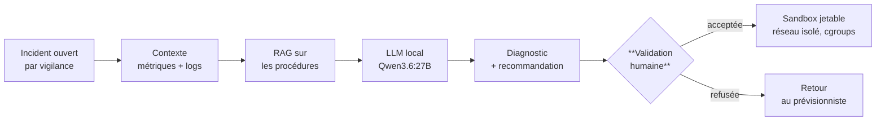
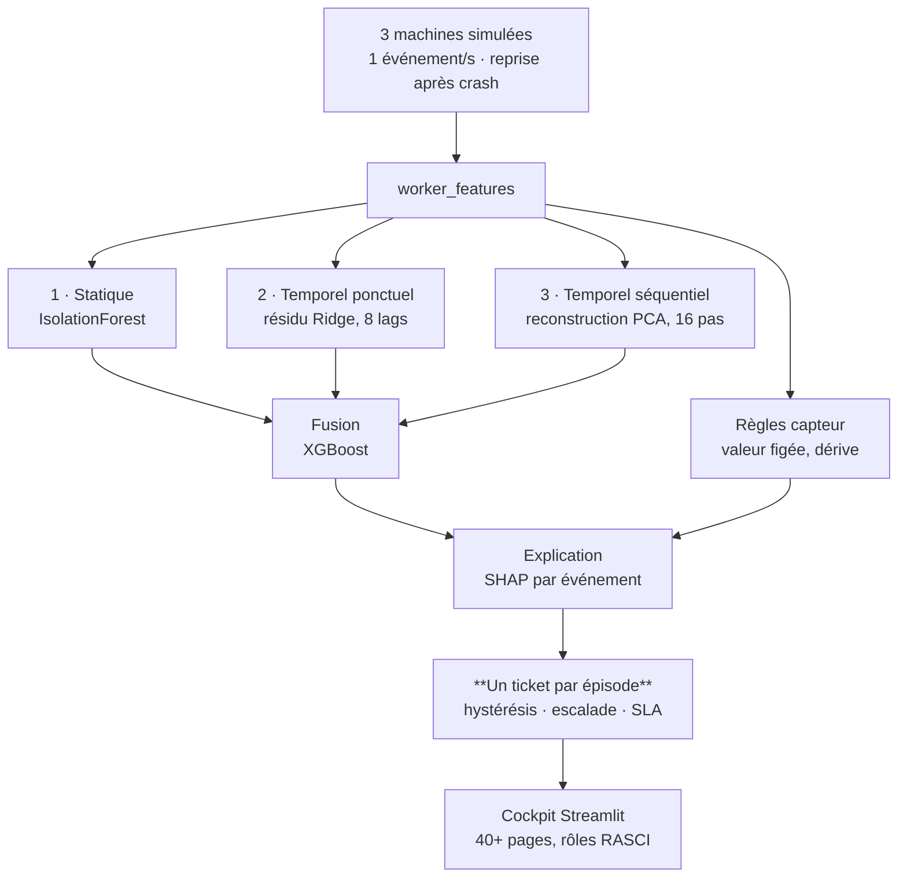

# Réinspection après corrections — brief de contre-audit

*Rédigé le 21/08/2026. Réponse attendue : **un fichier `.md`**, format imposé au § 6.*

---

## 0. Ce qui est différent de la première fois

Tu as audité ce portefeuille il y a deux jours et trouvé **27 défauts** répartis en deux
rapports — l'un éditorial, l'autre design. **Dix-sept ont été corrigés, neuf visuels sur neuf
ont été produits, et environ 400 lignes ont été retirées.**

**Ce brief ne redemande pas le même travail.** Il demande l'exercice plus difficile : vérifier
que les corrections ont **réellement** corrigé, et surtout **débusquer ce qu'elles ont cassé**.

> Sur ce projet, quatre corrections sur dix ont introduit un défaut nouveau. Une réécriture a
> retiré une affirmation trop large **et** la mesure qui la bornait. Une figure a été produite
> avec des étiquettes déplacées par une conversion de décimale appliquée aux coordonnées. Huit
> images ont été référencées par un chemin qui ne se résolvait pas. **C'est cette classe de
> défauts que je te demande de chercher.**

---

## 1. Les trois questions, par ordre d'importance

| | question |
|---|---|
| **① Régression** | qu'est-ce qu'une correction a **cassé, effacé ou déséquilibré** ? |
| **② Correction incomplète** | un défaut corrigé à un endroit **survit-il ailleurs** ? |
| **③ Ce qui reste** | parmi ce que tu avais signalé et qui n'a pas été traité, qu'est-ce qui compte encore ? |

**La question ① est la raison d'être de ce brief.** Une page qui a perdu sa réserve, un tableau
dont il ne reste que la moitié, une transition rompue par un retrait, un `<details>` qui avale
une section qui devait rester visible : voilà ce que je cherche.

---

## 2. Ce qui a été corrigé — la liste exhaustive, à contrôler

**Vérifie chacune.** Pour chaque ligne : la correction est-elle juste, complète, et sans dégât
collatéral ?

### Corrections de fond

1. **Faute de signe.** « le modèle apprend le résidu `observation − CAMS` et le **retranche** »
   → « apprend la **correction** `observation − CAMS`, puis l'**ajoute** ». Le code fait
   `corrige = cams + sortie`. Corrigé dans trois pièces.
2. **Périmètre FAIRMODE.** « 96,2 % après correction » était accolé à la promesse « là où
   personne ne mesure ». Le chiffre de cette promesse est **87,9 %**, sous le seuil de 90 %.
3. **Résultat tabulaire.** Trois pages donnaient 72,5 / +2,7 / oracle 78,3 ou 72,8 / +3,0 /
   78,7. Unifié sur **72,8, routeur source-strict**, protocole nommé. `72,5` désignait
   `tuned_dom`, un autre système.
4. **Deux piles sous le même libellé J+1.** « O₃ +17,9 % » et « O₃ +9,1 % » cohabitaient. Le
   balayage d'échéance utilise une **pile réduite identique aux quatre horizons** ; c'est dit.
5. **Conclusion TSAD.** L'affirmation universelle est retirée, et la strate négative
   (`−0,01` sur tout le multivarié) rétablie après avoir été perdue une première fois.
6. « 35+ compétitions **complétées** » → **engagées** · répartition annoncée **non exclusive**
   · « 9 workers, **4 réplicas** » → « 3 réplicas CPU + 1 GPU » · « reproductions exactes »
   précisé · deux superlatifs DELTAMU remplacés · « fuzzy matching » retiré de deux pages
   supplémentaires · « 9 domaines » → **10**.
7. **Promesses de déploiement retirées** : « Portfolio en ligne », « Deployed on GitHub
   Pages », « construit avec Quarto + GitHub Pages » — le site n'a jamais été construit.

### Retraits

8. `README.md` : citation générique, **34 badges** de stack → 4 lignes hiérarchisées.
9. `about.qmd` : « Réalisations marquantes » et « Compétences techniques » supprimées (−98 lignes).
10. `projets_Competitions` : méthodologie générique, « Valeur ajoutée », « Leçons apprises ».
11. `projets_Master_1` : six projets sur dix repliés dans un `<details>` imbriqué.
12. `projets_Master_2` : listes génériques de compétences et technologies.
13. `projets_Tuning_Data_Augmentation_Vision` : **fiche supprimée**.
14. `vigilance` : diagramme ASCII → **Mermaid**, implémentation repliée.
15. Dépôt qualité de l'air : installation, commandes, protocole et organisation **repliés**.
16. Les sept `::: {.panel-tabset}` → `<details>` avec `<summary>`.

### Visuels ajoutés — sept figures SVG et deux flux Mermaid

`V1` gain par polluant · `V3` FAIRMODE NO₂ avec le seuil 90 % · `V4` seuil 2030 (6 → 109) ·
`V5` échéances J0→J+3 · `V6` pile étage par étage · `V7` routeur tabulaire **en différences** ·
`V8` routage par dimension avec axe zéro · `V2` flux vigilance · `V9` flux Aegis.

---

## 3. Deux recommandations écartées, et pourquoi

Ce n'est pas un oubli, et je ne demande pas de les rediscuter — je te le dis pour que tu ne les
resignales pas :

- **le compte de notebooks Kaggle** (≈ 1 050) et **le bloc sur l'agentique** ont été demandés
  explicitement par l'auteur. Ils restent. Le second a toutefois été **borné** : « aucun
  classement ci-dessus ne lui est attribuable ».

Si leur **formulation** te paraît perfectible, dis-le. Leur présence n'est pas en jeu.

---

## 4. Les points de contrôle que je te demande de faire, précisément

Ce sont les endroits où une correction a le plus de chances d'avoir cassé quelque chose.

1. **Les `<details>`** — cinq fiches en ont, dont une **imbriquée** (`projets_Master_1`).
   Quelque chose d'important est-il désormais caché au premier passage ? Un `<summary>`
   annonce-t-il mal son contenu ?
2. **Les transitions** — les sections retirées laissaient-elles des phrases de liaison
   orphelines ? Un « comme vu plus haut » qui ne renvoie plus à rien ?
3. **Les figures contre leur texte** — chaque figure dit-elle la même chose que le paragraphe
   qui la précède ? Une figure remplace-t-elle un tableau dont une valeur n'apparaît plus nulle
   part ?
4. **Les textes alternatifs** — sont-ils exacts, et suffisants pour qui ne voit pas l'image ?
5. **La cohérence des chiffres après unification** — 72,8 apparaît-il partout, ou reste-t-il un
   72,5 quelque part ? Même question pour 87,9/96,2, pour +3,0, pour 10 domaines.
6. **Le premier écran de chaque page** — après retrait des badges et de la citation, la page
   d'accueil ouvre-t-elle mieux, ou a-t-elle perdu son point d'entrée ?
7. **L'équilibre entre réserve et résultat** — à force d'ajouter des réserves, une page
   finit-elle par se dévaluer ? Signale tout endroit où la prudence dessert.

---

## 5. Ce qui ne m'intéresse toujours pas

- ❌ les conseils génériques sans emplacement ni remplacement exact ;
- ❌ tout ce qui exige du CSS ou du JavaScript dans un README ;
- ❌ le fond scientifique, audité ailleurs avec les données ;
- ❌ ce qui découle du blocage du compte GitHub — un miroir GitLab public existe désormais et
  fonctionne (`gitlab.com/cyril.bgs.dev`), le problème est traité ;
- ❌ les propositions qui ne font qu'ajouter : le portefeuille a maigri de 400 lignes, il ne
  doit pas les reprendre.

---

## 6. Le format de réponse

```markdown
## Verdict en cinq lignes
(les corrections ont-elles tenu ? qu'est-ce qui a cassé ?)

## ① Régressions — ce qu'une correction a cassé
### [gravité] où · quoi
- **Avant / après** : ce qui existait, ce qui existe
- **Ce qui est perdu** : précisément
- **Réparation** : le texte exact à remettre ou à ajouter

## ② Corrections incomplètes
(même défaut, autre endroit — avec la citation)

## ③ Ce qui reste de ma première liste, et qui compte encore
(par ordre décroissant, avec ce qui a changé depuis)

## ④ Ce qui est mieux qu'avant
(sincère, 3 à 5 points — je dois savoir quoi ne pas défaire)
```

Gravité : `🔴 bloquant` · `🟠 important` · `🟡 confort`.

**Cite exactement.** Un défaut sans citation littérale n'est pas actionnable. Et **ne rapporte
que ce que tu as sous les yeux au § 7** — pas ce que tu te souviens d'avoir lu la première fois.

---

## 7. Le corpus, dans son état du 21/08/2026


---

## A — Le portefeuille


### 📄 `README.md`

*314 lignes · 1544 mots*

````markdown
<div align="center">

# 🚀 Cyril BOURGEOIS

### Data Scientist | MLOps Engineer | Problem Solver


[](https://www.linkedin.com/in/cyril-bourgeois/)
[](mailto:cyril.bgs.dev.tech@gmail.com)
[](https://www.kaggle.com/cyrilbourgeois)

---

</div>

## 🎯 À Propos

Data Scientist passionné avec **double compétence modélisation + production**, spécialisé en détection d'anomalies et systèmes MLOps temps réel. Mon parcours atypique (armée → commerce → data science) m'a apporté une perspective unique : **rigueur technique + sens du business + communication efficace**.

### 🏆 Faits Marquants

<table>
<tr>
<td width="33%" valign="top">
  
**🥇 Kaggle Top 1%**
- 35+ compétitions
- 3 top 1% mondial
- Meilleur rang : #14/3022

</td>
<td width="33%" valign="top">
  
**🔬 Benchmarks SOTA**
- ADBench : 47 datasets
- TSB-AD : 870 séries U + 200 M
- TSB-AD : 2 scores reproduits à l'identique<br>ADBench : 5 détecteurs réexécutés

</td>
<td width="33%" valign="top">
  
**⚙️ MLOps Temps Réel**
- DAG 9 workers · pool de 3 réplicas CPU + 1 GPU
- Dashboard 40+ pages RASCI
- Observabilité Prometheus/Grafana

</td>
</tr>
</table>

---

## 💼 Expérience Professionnelle

<div align="center">

### 🏭 Data Scientist - MICHELIN (Alternance)
*Février 2023 - Février 2024 · 39h/semaine, 4 jours/5 en entreprise*

</div>

**POC Parsing/Matching de Données Complexes — Niveau Continental**

🎯 **Mission** : Réalisation d'un POC de parsing/matching de données complexes, niveau continental

✨ **Réalisations** :
- 🎯 Augmentation considérable du taux de détection des correspondances
- 🧹 Nettoyage et qualité des données, analyses spécifiques autour du pricing niveau mondial
- ✅ Tests de non régression

💡 **Impact** :
- Vitesse d'exécution et résultats jugés excellents d'après plusieurs Product Owners
- Accélération considérable des temps de traitement par rapport au processus manuel
- POC mené jusqu'au bout et préparé pour la mise en production, adapté et utilisé par les équipes par la suite

🗣️ **Feedback** :
> *"Implication et capacité constante à se challenger. Force de proposition, assidu dans les missions. POC parsing/mapping mené avec succès."*  
> — Antoine DANIEL LAMAZIERE (PO) + Architecte Data

---

<div align="center">

### 🧪 Data Scientist / ML Engineer - DELTAMU (CDD)
*Octobre 2024 - Octobre 2025*

</div>

**Recherche en Détection d'Anomalies — Capteurs Industriels (Pharma)**

🎯 **Contexte** : Industrie pharma, plusieurs centaines de capteurs

✨ **Missions** :
- 🔬 Tests de recherche en clustering et détection d'anomalies
- 📊 Analyse et interprétation d'insights et de cycliques
- 🧠 Création d'un algorithme de niveau recherche validé par le responsable scientifique

💡 **Impact** :
- 📈 Analyses statistiques avancées sur ensemble de bon fonctionnement
- ⚡ Cœur calculatoire haute vitesse optimisé en **Rust**
- 🔍 Caractérisation des régimes de fonctionnement sur plusieurs centaines de capteurs

🗣️ **Feedback** :
> *"Réelle passion pour la data science et les algorithmes d'IA. Investissement dans les missions. Contribution active au produit logiciel."*  
> — Nuno DOS REIS, Président, DELTAMU

---

## 🎓 Formation

<div align="center">

| Master 2 - Data Scientist | Master 1 - Data Analyst |
|:---:|:---:|
| **OpenClassrooms + Centrale Supélec** (2024) | **OpenClassrooms + ENSAE** (2022) |
| 7 projets validés | 10 projets validés |
| Alternance Michelin (12 mois) | — |
| Deep Learning, NLP, Time Series | ML classique, SQL, BI |

</div>

---

## 🛠️ Stack Technique

<div align="center">

**Principal** — Python · SQL · scikit-learn · LightGBM/XGBoost · PyTorch · pandas/Polars

**Mise en production** — Docker · Redis · PostgreSQL · Prometheus/Grafana · Streamlit

**IA générative** — Claude · ChatGPT · Gemini · Mistral · Grok · Kimi K3 · *agentique* : Claude Code, Codex, OpenCode

**Aussi** — Rust (cœur calculatoire), CUDA, RealMLP, modèles pré-entraînés, TensorFlow, Tableau/Power BI

</div>

---

## 🚀 Projets Phares

### 🌬️ [Correction apprise des prévisions de qualité de l'air](projets_Qualite_Air/)
**Apprendre l'erreur du modèle européen, et la corriger** — 36 mois, 28 M de mesures horaires, 4 polluants

<div align="center">

<picture>
  <source media="(prefers-color-scheme: dark)" srcset="assets/v1_gain_polluants_sombre.svg">
  
</picture>

</div>

✨ **Highlights** :
- 🎯 **Prévoir là où personne ne mesure** : aucune observation du lieu corrigé n'entre dans le modèle — et il est testé sur des stations *et* des mois qu'il n'a jamais vus
- 📅 **En 2030 l'Europe divise ses seuils par deux** : à pollution inchangée, les stations en dépassement passent de **6 à 109** — et 4 départements d'Occitanie n'ont aucune station pour le constater
- ✅ **Utilisable au sens réglementaire&nbsp;?** **Sans aucune observation du point**, la part des stations NO₂ qui satisfait le critère européen passe de 41,4 % à **87,9 %** — encore sous le seuil de 90 %. **Aux stations instrumentées**, elle atteint **96,2 %**


- 🔍 **Les limites sont publiées comme les résultats** : 3 épisodes de pollution réels détectés sur 33 — l'observation directe elle-même n'en attrape que 21, et le produit officiel 1
- 💻 **Code** : [github.com/cyril-bgs-dev-tech/correction-previsions-qualite-air](https://github.com/cyril-bgs-dev-tech/correction-previsions-qualite-air)

<picture>
  <source media="(prefers-color-scheme: dark)" srcset="assets/v3_fairmode_no2_sombre.svg">
  
</picture>

---

### 🔧 [Système MLOps Temps Réel](vigilance/)
**Détection d'anomalies industrielle** - 1 200+ heures

<div align="center">


</div>

✨ **Highlights** :
- 🏗️ DAG event-driven : 9 workers, barrières Redis atomiques, DLQ, reprise après crash
- 🤖 3 canaux décorrélés (IsolationForest + Ridge temporel + PCA séquentiel) fusionnés par XGBoost + détection de nouveauté
- 🎫 Cycle de vie d'alarme en épisode unique : hystérésis, escalade, SLA par sévérité
- 📊 Dashboard Streamlit 40+ pages avec rôles RASCI
- 🔭 Observabilité par étape du DAG : Prometheus + Grafana + cAdvisor
- 💻 **Code** : [github.com/cyril-bgs-dev-tech/vigilance](https://github.com/cyril-bgs-dev-tech/vigilance)

---

### 🕵️ [Aegis-RCA — Agent de Diagnostic de Causes Racines](aegis-rca/)
**Prototype de recherche actif** — extension de vigilance, 3 jours de développement (juillet 2026)

✨ **Highlights** :
- 🤖 Agent LLM local (Qwen3.6:27B) qui investigue les incidents ouverts par vigilance : contexte métriques, RAG sur procédures, diagnostic + recommandation validés par un humain
- 🔬 Décisions d'architecture confrontées à des avis externes (Gemini, ChatGPT) **puis vérifiées par des bancs de mesure réels** — une erreur de méthodologie détectée et corrigée en cours de route, documentée telle quelle
- 🛡️ Sandbox d'auto-correction durci (Docker jetable, réseau isolé, cgroups) — 1 succès réel mesuré
- 💻 **Code** : [github.com/cyril-bgs-dev-tech/aegis-rca](https://github.com/cyril-bgs-dev-tech/aegis-rca)

---

### 🔬 [Recherche Compositionnelle - Anomaly Detection](anomaly_tabular/)
**Composer les SOTA et router par domaine — ADBench (tabulaire) + TSB-AD (séries temporelles)**

<div align="center">


-%231%20des%202%20volets%20TSB--AD-10B981?style=for-the-badge)


</div>

✨ **Highlights** :
- 🎯 Démarche : reproduire l'ancre (égalités exactes : Sub-PCA 0.4234, Sub-KNN 0.3501) → monter les SOTA → **caractériser les domaines** → router
- 🥇 PaAno (ICLR 2026) intégré à TSB-AD et certifié : **#1 des volets U et M** (0.58 / 0.46 VUS-PR vs 0.42 / 0.31 pour les leaders publiés)
- 📈 Tabulaire : **routeur source-strict 72,8 AUROC** (pré-enregistré, LODO groupé par source) contre **69,8** pour le meilleur détecteur unique — soit **+3,0 points** ; oracle du corpus à **78,7**
- 💡 Leçon : même avec un système SOTA, la composition par domaine ajoute jusqu'à +0.33 VUS-PR localement
- 🔬 Volets : [tabulaire](anomaly_tabular/) · [séries temporelles](anomaly_tsad/) — dépôts : [anomaly_tabular](https://github.com/cyril-bgs-dev-tech/anomaly_tabular) · [anomaly_tsad](https://github.com/cyril-bgs-dev-tech/anomaly_tsad)

---

### 🏆 [Compétitions Kaggle - Top 1% Mondial](projets_Competitions/)
**35+ compétitions** | **3 top 1%**

<div align="center">

| Compétition | Rang | Top % |
|:---|:---:|:---:|
| 🏎️ Prediction F1 Pit Stop | #14 / 3 022 | 0.5% |
| 🌾 Predicting Irrigation Need | #32 / 4 315 | 0.7% |
| 🎧 Predict Podcast Listening | #20 / 3 310 | 0.6% |
| 🏠 Regression California Housing | #14 / 689 | 2% |

</div>

✨ **Approche** :
- 🔧 Feature engineering intensif (centaines de features)
- 🤝 Ensembling/stacking de modèles diversifiés
- ⚡ Optimisation bayésienne (Optuna)
- 🔬 Veille active (TabM, TabICL2, RealMLP)
- 🤖 La stratégie gagnante se déplace vers l'**agentique** — des systèmes d'agents qui explorent et sélectionnent les pistes en autonomie
- 🏅 **Palmarès vérifiable** : [kaggle.com/cyrilbourgeois](https://www.kaggle.com/cyrilbourgeois/competitions)

---

## 📂 Structure du Portfolio

<div align="center">

```
📦 Portfolio
├── 🎓 projets_Master_1/  # 10 projets Data Analyst
├── 🎓 projets_Master_2/  # 7 projets Data Scientist + Michelin
├── 🏆 projets_Competitions/  # 35+ compétitions Kaggle
├── 🌬️ projets_Qualite_Air/  # Correction apprise des prévisions CAMS
├── 🔧 vigilance/  # Système MLOps temps réel
├── 🕵️ aegis-rca/  # Agent de diagnostic de causes racines
├── 🔬 anomaly_tabular/  # Recherche tabulaire
└── 🔬 anomaly_tsad/  # Recherche time series
```

</div>

---

## 🎯 Ce Que Je Recherche

<div align="center">

### 🚀 Opportunités

</div>

- **Data Scientist** : Projets ML/DL complexes, détection d'anomalies
- **MLOps Engineer** : Mise en production de modèles, systèmes temps réel
- **Research Engineer** : État de l'art, benchmark, nouvelles architectures

### 🌟 Environnement Idéal

- ✅ Équipe technique passionnée et collaborative
- ✅ Problématiques business à fort impact
- ✅ Stack moderne (Python, cloud, MLOps)
- ✅ Culture data-driven et innovation

---

## 📫 Contact

<div align="center">

**📧 Email** : [cyril.bgs.dev.tech@gmail.com](mailto:cyril.bgs.dev.tech@gmail.com)  
**💼 LinkedIn** : [linkedin.com/in/cyril-bourgeois](https://www.linkedin.com/in/cyril-bourgeois/)  
**🏆 Kaggle** : [kaggle.com/cyrilbourgeois](https://www.kaggle.com/cyrilbourgeois)  
**🐙 GitHub** : [github.com/cyril-bgs-dev-tech](https://github.com/cyril-bgs-dev-tech)

</div>

---

<div align="center">

### 🌟 *"Le code ne ment jamais, les commentaires oui"* - Linus Torvalds

*Sources et résultats bruts versionnés — chaque chiffre est régénérable.*


*Dernière mise à jour : Août 2026*

</div>

````

### 📄 `about.qmd`

*134 lignes · 586 mots*

````markdown
---
title: "À Propos"
---

## 🎯 Mon Parcours

### De l'Armée à la Data Science

**Background atypique** : Reconversion professionnelle de l'armée vers le commerce, puis vers la data science (2021-2024).

Ce parcours m'a apporté :
- **Rigueur et discipline** (armée)
- **Sens du client et communication** (commerce)
- **Compétences techniques** (data science)

---

## 🎓 Formation

### Master 2 - Data Scientist (2023-2024)
**OpenClassrooms + Centrale Supélec**

- 7 projets validés
- Alternance **MICHELIN** (12 mois)
- POC parsing/matching de données complexes
- Deep Learning, NLP, Time Series, Détection d'anomalies

### Master 1 - Data Analyst (2021-2022)
**OpenClassrooms + ENSAE**

- 10 projets validés
- Analyse exploratoire, SQL, ML classique
- Outils : Python, SQL, KNIME, Tableau, Power BI

---

## 💼 Expérience Professionnelle

### Alternance Data Scientist - MICHELIN (Fév 2023 - Fév 2024)
*39h/semaine, 4 jours/5 en entreprise*

**POC Parsing/Matching de Données Complexes — Niveau Continental**

**Missions** :
- Réalisation d'un POC de parsing/matching de données complexes, niveau continental
- Rapprochement automatisé de données de pricing hétérogènes, et tests de non-régression
- Nettoyage et qualité des données, analyses spécifiques autour du pricing niveau mondial
- Tests de non régression

**Résultats** :
- Vitesse d'exécution et résultats jugés excellents d'après plusieurs Product Owners
- Accélération considérable des temps de traitement par rapport au processus manuel
- POC mené jusqu'au bout et préparé pour la mise en production, adapté et utilisé par les équipes par la suite

**Feedback** :
> *"Implication et capacité constante à se challenger. Force de proposition, assidu dans les missions. POC parsing/mapping mené avec succès."*
> 
> — Antoine DANIEL LAMAZIERE (PO) + Architecte Data, Michelin

---

### CDD Data Scientist / ML Engineer - DELTAMU (Oct 2024 - Oct 2025)

**Recherche en Détection d'Anomalies — Capteurs Industriels (Pharma)**

**Contexte** : Industrie pharma, plusieurs centaines de capteurs

**Missions** :
- Tests de recherche en clustering et détection d'anomalies
- Analyse et interprétation d'insights et de cycliques
- Création d'un algorithme de niveau recherche validé par le responsable scientifique

---

## 🎓 Certifications et Diplômes

- **Master 2 Data Scientist** - OpenClassrooms + Centrale Supélec (2024)
- **Master 1 Data Analyst** - OpenClassrooms + ENSAE (2022)
- **Kaggle Competitions** : Top 1% mondial (3 compétitions)

---

## 📚 Centres d'Intérêt

### Veille Technologique
- Papiers de recherche (NeurIPS, ICML, ICLR)
- Nouvelles architectures (Transformers, GNN, Foundation Models)
- Compétitions Kaggle (feature engineering, ensembling)

### Domaines d'Application
- Détection d'anomalies (tabulaire, time series)
- Maintenance prédictive
- Pricing et prévision
- NLP et computer vision

### Open Source
- Contribution à des projets communautaires
- Partage de solutions et notebooks
- Documentation et tutoriels

---

## 📫 Contact

**Email** : [cyril.bgs.dev.tech@gmail.com](mailto:cyril.bgs.dev.tech@gmail.com)  
**GitHub** : [github.com/cyril-bgs-dev-tech](https://github.com/cyril-bgs-dev-tech)  
**LinkedIn** : [linkedin.com/in/cyril-bourgeois](https://www.linkedin.com/in/cyril-bourgeois/)

---

## 📄 Lettres de Recommandation

### Michelin (2023-2024)
**Antoine DANIEL LAMAZIERE** (Product Owner) + **Architecte Data**

> *"Implication et capacité constante à se challenger. Maîtrise des solutions de développement et mise en œuvre. Curiosité et motivation, intérêt pour problématiques Data Business. Force de proposition, assidu dans les missions."*

### OpenClassrooms (2022)
**Hamza Tajmouati** (Head of AI chez Iktos, Mentor OpenClassrooms)

> *"Grande autonomie, proactivité et motivation. Curiosité et recherche constante d'amélioration. Doué en programmation et en compréhension théorique."*

### Deltamu (2026)
**Nuno DOS REIS** (Président)

> *"Réelle passion pour la data science et les algorithmes d'IA. Investissement dans les missions, contribution active au produit logiciel."*

---

*Dernière mise à jour : Août 2026*

---

**Commencer par** : [correction de prévisions de qualité de l'air](projets_Qualite_Air/index.qmd) — le projet le plus abouti, protocole et limites publiés.

````

### 📄 `aegis-rca/README.md`

*88 lignes · 1070 mots*

````markdown
# 🕵️ Aegis-RCA — Agent de Diagnostic de Causes Racines

**Vision** : une fois que [vigilance](../vigilance/) détecte une anomalie, Aegis-RCA l'investigue — corrèle le contexte, consulte les procédures, propose un diagnostic et une recommandation, toujours soumis à validation humaine avant toute action.

**Contexte** : projet personnel, extension directe de vigilance (2026)
**Durée** : prototype développé sur 3 jours (17-19 juillet 2026)

**Où en est ce projet** :
- ✅ Fait : consommation des tickets vigilance, corrélation métriques Prometheus, RAG sur base de connaissance (procédures/post-mortems), sandbox d'auto-correction fonctionnel (1 succès mesuré), méthodologie d'évaluation rigoureuse (bancs internes avec seuils fixés à l'avance)
- 🚧 Pas encore fait : mémoire long-terme des corrections opérateur, observabilité de production, déploiement cloud (décisions documentées, pas construites) — c'est un prototype de recherche de 3 jours, pas un produit fini

---

## 🧑‍💼 Vue d'ensemble

**Le problème** : un système de détection d'anomalies comme `vigilance` dit *qu'*une machine se comporte anormalement — mais pas toujours *pourquoi*. Un opérateur reçoit une alerte et doit encore chercher la cause, consulter les procédures pertinentes, et décider quoi faire. C'est ce travail d'investigation qu'Aegis-RCA prend en charge automatiquement.

**Comment ça marche, en clair** : dès qu'un incident est ouvert, un agent (basé sur un modèle de langage exécuté en local, pas dans le cloud) rassemble le contexte — les métriques autour de l'incident, l'historique de la machine, les procédures internes pertinentes — puis rédige un diagnostic avec sa recommandation. Rien n'est exécuté automatiquement : un humain valide toujours avant qu'une action ne soit prise.

**Ce qui distingue ce projet, ce n'est pas juste "il y a un agent IA"** — c'est la méthode : chaque choix d'architecture a été soumis à l'avis de plusieurs IA différentes (Gemini, ChatGPT) puis vérifié contre des mesures réelles avant d'être adopté. Un exemple concret : un premier test semblait montrer que la technique choisie pour fiabiliser l'agent fonctionnait parfaitement (100 % de réussite) — une vérification plus poussée a révélé que ce succès venait en fait d'un détail différent du prompt, pas de la technique testée. Cette erreur a été détectée et corrigée avant de tirer une conclusion, plutôt que d'afficher un chiffre flatteur mais faux.

**Ce que ça démontre** : la capacité à construire un système d'IA agentique avec la même rigueur qu'une démarche scientifique — mesurer plutôt que supposer, documenter les échecs autant que les réussites, et rester honnête sur ce qui n'est pas encore prouvé (le module d'auto-correction n'a qu'un seul succès mesuré à ce stade, pas un taux fiable).

<details>
<summary><strong>🔧 Détails techniques</strong> — cliquer pour déplier</summary>

## Ce que l'agent fait, et où l'humain décide



**La frontière est le sujet du projet** : l'agent instruit le dossier, il ne clôt jamais
l'incident seul. Tout ce qui suit la validation tourne dans un bac à sable jetable, sans réseau.

## Architecture

- `aegis/consumer.py` — consommateur Redis at-least-once, anti-poison (ACK systématique) sur le flux `aegis:incidents` de vigilance
- `aegis/agent/investigator.py` — agent d'investigation : LLM local (Qwen3.6:27B via Ollama), orchestré par une machine à états Python explicite (pas de framework agent type LangGraph — décision mesurée, voir plus bas)
- `aegis/rag/` — RAG hybride (Qdrant) sur une base de connaissance versionnée : procédures (SOPs), post-mortems, fiches de référence
- `aegis/sandbox/` — auto-correction : exécution de code généré dans un conteneur Docker jetable et durci (user non-root, rootfs read-only, `--network=none`, cgroups pids-limit anti fork-bomb)
- `aegis/tools/metrics.py` — tool typé Prometheus (requêtes curées, best-effort)
- API FastAPI : `/health`, `/incidents`, `/incidents/{ticket}`

## Méthode — pas de décision d'architecture sans confrontation au réel

Chaque choix structurant a été soumis à deux avis externes (Gemini, ChatGPT) **puis vérifié contre le code et des bancs de mesure réels** avant adoption. Deux exemples représentatifs :

- **Tool-calling** : un premier banc semblait valider un stack à 100 % de succès. Une bissection plus poussée a montré que le succès venait d'un exemple JSON littéral présent dans le prompt système, pas de la contrainte de décodage structuré qu'on pensait tester — le banc validait le mauvais mécanisme. Correction appliquée avant d'écrire la moindre conclusion.
- **Machine à états maison vs LangGraph** : décision de rester sur une machine à états explicite tant que le graphe reste sous ~15 nœuds et qu'aucune pause n'est nécessaire en milieu d'exécution — le seuil de bascule est documenté explicitement, pas choisi par défaut.
- **Évaluation sans vérité terrain** : rubrique de questions binaires plutôt qu'une note globale (qui récompense la longueur), "fidélité au contexte" comme métrique reine, juge ≠ générateur (Qwen génère, mistral-small juge), comparaisons A/B systématiquement permutées, stabilité du juge mesurée avant d'y faire confiance.

## Preuves (bancs internes, résultats bruts versionnés)

| Banc | Résultat |
|---|---|
| Tool-calling (qwen3.6:27B, 300 appels) | 100 % JSON valide / outil correct / arguments corrects, une fois le piège ci-dessus corrigé |
| Incidents à cause connue (gate Phase C, 14 cas dont cas ambigus à dessein) | 6 itérations avant un run conforme aux seuils fixés à l'avance — runs ratés conservés, pas masqués |
| Auto-correction (sandbox) | 1 succès mesuré : 1 itération, 9,6 s, modèle réel |
| Calibration du juge | Stabilité mesurée sur répétitions, juge différent du générateur |
| Retrieval RAG | hit@1 = 0,969 · hit@4 = 1,000 · MRR = 0,984 sur 32 requêtes |

## Limites honnêtes

- Prototype de 3 jours de développement, Phase A/B seulement
- L'auto-correction n'a qu'une seule preuve de succès mesurée — pas un taux statistiquement robuste
- Nécessite le réseau Docker externe de vigilance pour tourner
- Mémoire long-terme, observabilité de production et déploiement cloud : décisions documentées, pas encore construites

## Prochaine étape — boucle de feedback fermée avec vigilance

Les diagnostics validés (ou corrigés) par un opérateur constituent des labels de cause racine que [vigilance](../vigilance/) n'a pas aujourd'hui (sa couche supervisée ne distingue qu'anomalie/pas-anomalie). L'architecture mémoire déjà décidée (tickets résolus indexés dans Qdrant + corrections humaines structurées) est le prérequis naturel : une fois construite, elle alimente à la fois le réentraînement de vigilance et l'élargissement du banc d'évaluation d'Aegis au-delà des 14 cas actuels.

---

**Code source** : [github.com/cyril-bgs-dev-tech/aegis-rca](https://github.com/cyril-bgs-dev-tech/aegis-rca)
**Projet frère** : [vigilance](../vigilance/) (le système qu'Aegis-RCA investigue)
**Dernière mise à jour** : Août 2026
**Contact** : cyril.bgs.dev.tech@gmail.com

</details>

````

### 📄 `anomaly_tabular/README.md`

*98 lignes · 1179 mots*

````markdown
# 🔬 Recherche Compositionnelle — Détection d'Anomalies Tabulaire

**Thèse** : aucun détecteur d'anomalies ne domine partout. Plutôt que de chercher un modèle miracle, on **compose** les meilleurs détecteurs (SOTA inclus) et on apprend **quand utiliser lequel** — en caractérisant les domaines de données. La performance vient de la sélection, pas d'un énième détecteur.

**Où en est ce projet** :
- ✅ Fait : 5 détecteurs de référence reproduits sur 47 datasets (ADBench), corpus étendu à 502 datasets / 20 domaines, système de sélection par domaine validé en LODO préenregistré (+3.0 pts vs meilleur détecteur unique) — résultats bruts par dataset publiés (502 lignes)
- 🚧 Pas encore fait : le harnais de calcul complet n'est pas encore extrait dans ce dépôt public sous une forme ré-exécutable par un tiers — la méthodologie, les résultats consolidés et les données brutes y sont, pas encore le code

**📊 [Présentation interactive](https://cyril-bgs-dev-tech.github.io/anomaly_tabular/)** — résultats par domaine, tous les constats (y compris les négatifs), enseignements.

---

## 🧑‍💼 Vue d'ensemble

**La question posée** : pour détecter des anomalies dans des données tabulaires (transactions, mesures, dossiers...), existe-t-il un détecteur qui marche mieux que tous les autres, quel que soit le domaine ? Beaucoup de projets s'arrêtent au premier modèle qui bat une baseline.

**Ce qu'on a trouvé** : le détecteur qui gagne change selon le domaine — un modèle par diffusion domine sur des données d'activité, un modèle causal sur des données agricoles, un autre sur de l'audio. Plutôt que de chercher LE détecteur universel, la solution est de **reconnaître le domaine** et d'y assigner le détecteur qui y excelle réellement.

**Pourquoi c'est rigoureux et pas juste une intuition** : avant de prétendre faire mieux que les résultats publiés dans la recherche académique (ADBench, la référence du domaine), la première étape a été de **reproduire exactement** ces résultats — c'est la garantie que les comparaisons qui suivent sont fiables et pas un artefact de mesure.

**Le résultat chiffré** : le système de sélection par domaine dépasse le meilleur détecteur unique de +3.0 points de précision (AUROC) — un gain confirmé statistiquement (pas un hasard de mesure) et vérifié sur des données jamais vues pendant la mise au point.

**Une découverte utile en soi** : sur environ un tiers des jeux de données (les cas "mal posés", où même les méthodes classiques peinent), ce sont les modèles de dernière génération ("foundation models") qui prennent le relais — alors qu'ils sont plutôt décevants en moyenne. Savoir *quand* changer d'outil est aussi précieux que l'outil lui-même.

**Ce que ça démontre** : la capacité à mener une recherche appliquée avec la même rigueur qu'une publication scientifique (hypothèses figées avant les résultats, vérification systématique), tout en restant honnête sur les limites (le gain est nul sur certains domaines, et c'est dit clairement).

<picture>
  <source media="(prefers-color-scheme: dark)" srcset="../assets/v7_routeur_tabulaire_sombre.svg">
  
</picture>

<details>
<summary><strong>🔧 Détails techniques</strong> — cliquer pour déplier</summary>

## 1️⃣ Le benchmark de base (l'ancre)

**ADBench** — la référence académique du domaine : 47 datasets tabulaires classiques, protocoles et hyperparamètres officiels (dépôts de référence clonés, pas réinventés).

## 2️⃣ Reproduction — le harnais doit être exact avant tout

Reproduction des détecteurs de référence avec un harnais maison (pool de processus ~28 workers, 1 thread BLAS/worker, cache reprenable — un crash ne perd aucun calcul) :

| Détecteur | Score reproduit (protocole ADBench, 47 datasets) |
|-----------|-----------------|
| IsolationForest | 0.762 |
| COPOD | 0.744 |
| ECOD | 0.742 |
| PCA | 0.740 |
| KNN | 0.699 |

Chaque écart au publié passe par une checklist : métrique, splits/seeds, hyperparamètres, préprocessing, version des données, variance, librairies.

## 3️⃣ Nos modèles sur le même banc d'essai

- **Champion maison (famille MRCD, covariance robuste)** — évalué en **préenregistrement** (hypothèses figées avant les runs) : **+1.5 pt d'AUROC médian vs IsolationForest** (p = 1.3×10⁻⁵ sur 92 datasets à anomalies natives), généralisation confirmée **hors échantillon** (+3.1 pts sur 74 datasets jamais vus). Lecture honnête, publiée telle quelle : effet réel mais modeste, nul face à KNN — ce filon seul ne suffit pas.
- **Pool de 18 « rails »** : détecteurs spécialisés par mécanisme (distance, densité, reconstruction, spectral, diffusion, covariance robuste…) + 2 **foundation models** tabulaires (TabICL, TabPFN), tous évalués au même protocole.

## 4️⃣ Spécialiser le benchmark : caractérisation des domaines

Extension du corpus à **502 datasets / 20 domaines applicatifs** (médical, vision, pharma, finance, réseau, génomique, industrie, audio…), avec méta-features label-free par dataset. Deux découvertes structurantes :

- **Le champion change selon le domaine** : diffusion #1 en activité, modèle causal non-linéaire #1 en agriculture, entropie spectrale #1 en audio… Le « meilleur détecteur global » n'est le meilleur presque nulle part.
- **Découverte des régimes** : 168/502 datasets sont « mal posés » (IF-AUC < 0.55). Sur ce régime, les **foundation models dominent** tous les détecteurs classiques — alors qu'ils sont médiocres en moyenne globale. Le signal de routage existe.

## 5️⃣ L'extension par domaines — et les scores

Système **tuned-domaine** : configuration du pool figée par domaine, validée en **LODO préenregistré** (leave-one-dataset-out) :

| Système | AUROC moyen | Lecture |
|---|---:|---|
| IsolationForest (baseline) | 63.8 | largement dépassée |
| KNN (meilleur détecteur unique) | 69.8 | le « SOTA single » |
| Ensemble 18 rails (fusion plate) | 71.3 | déjà mieux que tout single |
| **Routeur source-strict (préenregistré, LODO groupé par source)** | **72.8** | bat KNN de +3.0 pts — headline |
| Oracle du pool (sélection parfaite) | 78.7 | le plafond à capturer |

Gains par domaine du routage : **+5.1 pts environnement, +3.3 agriculture, +3.0 réseau** — et honnêtement 0.0 sur médical/finance (domaines où le signal de routage reste à trouver).

## 💡 Aparté — combien gagne-t-on au-dessus d'un système SOTA ?

Même en partant du **meilleur détecteur unique** (KNN, 69.8), la composition rapporte **+3.0 pts** aujourd'hui — et le plafond de sélection parfaite est à **+8.9 pts** (oracle 78.7). Autrement dit : ~70 % du gain accessible n'est **pas encore capturé**, et il se trouve dans la sélection, pas dans un 19ᵉ détecteur (démontré par screening systématique : les candidats supplémentaires n'élèvent plus l'oracle).

## 🧭 Prochaines actions intelligentes

1. **Méta-routeur par dataset** (au-delà du domaine) : kNN-sélecteur puis LightGBM en ranking des rails, méta-features label-free uniquement, validation LODO **nichée** — objectif : battre 72.8
2. **Proxy label-free du régime « mal posé »** (critère : corrélation > 0.5) → routage ciblé des foundation models
3. **Fusion pondérée par point** plutôt que sélection dure par dataset (la pondération douce bat déjà la fusion plate de +0.9)
4. **Corpus : grandir en natif** (~200 datasets à anomalies réelles) + lot de réplication séquestré
5. **Baseline concurrente MetaOD** re-run au même protocole + courbe de scaling du routeur (100 → 250 → 502 datasets) — les conditions de publiabilité

---

**Dépôt dédié** : [github.com/cyril-bgs-dev-tech/anomaly_tabular](https://github.com/cyril-bgs-dev-tech/anomaly_tabular)  
**Projet frère** : [Recherche time series](../anomaly_tsad/) (TSB-AD, PaAno, routage par domaine)  
**Dernière mise à jour** : Août 2026  
**Contact** : cyril.bgs.dev.tech@gmail.com

</details>

````

### 📄 `anomaly_tsad/README.md`

*102 lignes · 1138 mots*

````markdown
# 🔬 Recherche Compositionnelle — Détection d'Anomalies Séries Temporelles

**Thèse** : même le meilleur modèle SOTA ne domine pas partout sur les séries temporelles. On reproduit le benchmark de référence, on y monte les SOTA les plus récents, puis on **caractérise les domaines** pour router le bon détecteur vers la bonne série — et on mesure ce que cette composition rapporte **au-dessus** du SOTA.

**Où en est ce projet** :
- ✅ Fait : benchmark de référence reproduit à l'exact, dernier état de l'art (PaAno, ICLR 2026) intégré et certifié #1, caractérisation des domaines et gains de routage mesurés en LODO préenregistré
- 🚧 Pas encore fait : le harnais de code n'est pas encore extrait dans ce dépôt public sous une forme reproductible par un tiers — seuls la méthodologie et les classements consolidés y sont aujourd'hui

**📊 [Présentation interactive](https://cyril-bgs-dev-tech.github.io/anomaly_tsad/)** — classements complets, tous les constats, enseignements.

---

## 🧑‍💼 Vue d'ensemble

**La question posée** : face à un signal (température, vibration, trafic réseau...) qui part en dérive, existe-t-il UN modèle qui détecte le mieux les anomalies, quel que soit le type de données ? Beaucoup de recherches cherchent "le" meilleur modèle universel.

**Ce qu'on a trouvé** : non, ce modèle universel n'existe pas. Le meilleur détecteur pour des données médicales n'est pas le même que pour des données de serveurs informatiques ou de capteurs industriels. Plutôt que de chercher LE modèle miracle, l'approche ici est de **reconnaître automatiquement le type de données** et d'assigner le bon outil au bon problème — comme un chef d'orchestre qui assigne le bon musicien à la bonne partition plutôt que de chercher un instrument qui joue tout parfaitement.

**Pourquoi c'est rigoureux et pas juste une intuition** : avant de prétendre faire mieux que les modèles publiés dans la recherche académique, la première étape a été de **reproduire exactement** leurs résultats publiés — sans ça, impossible de savoir si un gain mesuré ensuite est réel ou un artefact de mesure. Cette étape de vérification est ce qui distingue une démarche scientifique sérieuse d'un simple benchmark marketing.

**Le résultat chiffré** : en intégrant le modèle le plus récent de la recherche (2026) et en le combinant avec ce routage par domaine, le système obtient de meilleurs résultats que n'importe quel modèle utilisé seul — l'écart grandit avec la complexité des données (plusieurs capteurs corrélés plutôt qu'un seul).

**Ce que ça démontre** : la capacité à mener une recherche appliquée avec la même rigueur qu'une publication scientifique (protocoles figés à l'avance, vérifications anti-triche), tout en gardant un œil sur l'utilité pratique du résultat.

<details>
<summary><strong>🔧 Détails techniques</strong> — cliquer pour déplier</summary>

## 1️⃣ Le benchmark de base (l'ancre)

**TSB-AD** — 870 séries univariées + 200 multivariées, issues de sources réelles (aérospatial, SCADA industriel, serveurs IT, médical, éolien…).

**Rigueur assumée** : **VUS-PR** en métrique primaire, le **point-adjust est banni** (il gonfle artificiellement les scores — biais documenté), endpoint d'évaluation natif du benchmark, validation LODO par **source** de données (jamais par série : pas de fuite).

## 2️⃣ Reproduction — des égalités exactes au publié

| Détecteur | Publié (VUS-PR moyen) | Reproduit | Statut |
|-----------|--------|-----------|--------|
| Sub-PCA (U, 350 séries) | 0.4234 | 0.4234 | ✅ **exact** |
| Sub-KNN (U) | 0.3501 | 0.3501 | ✅ **exact** |
| POLY (U) | 0.3898 | 0.3899 | ✅ |
| CNN (M, 180 séries) | 0.313 | 0.3171 | ✅ écart diagnostiqué |

SOTA récents montés et validés sur RTX 5090 : MOMENT (foundation, zero-shot), TranAD, AnomalyTransformer, FITS, Donut, OFA — plus les blocages documentés (Chronos/TimesFM : environnements isolés ; TimesNet : kernel CUDA incompatible Blackwell).

## 3️⃣ Le SOTA le plus récent sur le même banc : PaAno devient #1

**PaAno** (ICLR 2026, représentation par patchs) n'était pas classé sur TSB-AD. On l'a intégré au protocole officiel, **certifié en pleine résolution** (reproduction conforme au papier : 0.412 vs 0.426 publié sur Eva-M), puis classé contre tout le leaderboard :

| Volet | PaAno | Leader publié précédent | Rang |
|-------|-------|------------------------|------|
| Univarié (350 séries, 33 méthodes) | **0.58** VUS-PR moyen | Sub-PCA 0.42 | 🥇 #1 (rang moyen 7.8 vs 12.6 au suivant) |
| Multivarié (180 séries, 24 méthodes) | **0.46** VUS-PR moyen | CNN 0.31 | 🥇 #1 (rang moyen 7.3) |

Un écart pareil vs le publié impose la paranoïa méthodologique : mêmes splits Eva, protocole officiel, runs pleine longueur sur les séries > 250k points, vérification anti-fuite — d'où la certification avant tout claim.

## 4️⃣ Spécialiser le benchmark : caractérisation des domaines

Le corpus multivarié est caractérisé en **10 domaines applicatifs** (aérospatial, SCADA industriel, serveurs/ITops, éolien-solaire, médical cardiaque, médical neuro, robotique/drones, finance, wearables, eau/environnement) + méta-features par série (dimension, périodicité, non-stationnarité, corrélation inter-canaux…).

**Constat clé** : le champion varie par domaine — PaAno domine en robotique/finance/wearables, mais la **covariance robuste (Mahalanobis)** gagne en SCADA, le **spectral** en serveurs ITops et médical neuro, la **dynamique de corrélation** en eau/environnement.

## 5️⃣ L'extension par domaines — et les scores

Routage tuned-domaine validé en LODO, gains **au-dessus du meilleur global** par domaine :

| Domaine | Gain LODO (VUS-PR) | Rail gagnant |
|---------|-------------------:|--------------|
| Serveurs / ITops | **+0.33** | spectral |
| Médical cardiaque | **+0.27** | champion covariance |
| Médical neuro | **+0.11** | Mahalanobis |
| Éolien-solaire | +0.01 | Mahalanobis |

Et le signal le plus intéressant — **le gain du routage croît avec la dimensionnalité** :

<picture>
  <source media="(prefers-color-scheme: dark)" srcset="../assets/v8_routage_dimension_sombre.svg">
  
</picture>


Les séries quasi-univariées (d = 2) diluent le signal : le routage compositionnel est une stratégie **du multivarié réel**.

## 💡 Aparté — combien gagne-t-on au-dessus d'un système SOTA ?

Même en déployant PaAno partout (le #1 absolu), la spécialisation par domaine ajoute jusqu'à **+0.33 de VUS-PR** localement, et l'oracle du pool laisse **+0.16 à +0.24** de marge selon la dimension. Le SOTA global est un excellent défaut — pas une stratégie optimale : sur les benchmarks hétérogènes, **la composition bat le champion**.

## 🧭 Prochaines actions intelligentes

1. **Benchmark & routeur « multivarié pur »** (d ≥ 8) — là où le signal de routage est démontré
2. **Proxy label-free de difficulté** par série (le routage ne doit dépendre d'aucun label)
3. **Warm-start par source** : les deltas warm vs cold montrent qu'un historique de la source vaut des points (jusqu'à +0.44 en médical neuro)
4. **Corpus qualité** : ≥ 800 séries / ≥ 12 domaines avec gates de qualité par série
5. **Préenregistrement + réplication séquestrée** des claims de routage (même discipline que le volet tabulaire)

---

**Dépôt dédié** : [github.com/cyril-bgs-dev-tech/anomaly_tsad](https://github.com/cyril-bgs-dev-tech/anomaly_tsad) (classements complets inclus)  
**Projet frère** : [Recherche tabulaire](../anomaly_tabular/) (ADBench, 502 datasets, 20 domaines)  
**Dernière mise à jour** : Août 2026  
**Contact** : cyril.bgs.dev.tech@gmail.com

</details>

````

### 📄 `index.qmd`

*186 lignes · 1045 mots*

````markdown
---
title: "Cyril BOURGEOIS"
subtitle: "Data Scientist | MLOps Engineer"
about:
  template: jolla
  links:
    - icon: github
      text: GitHub
      href: https://github.com/cyril-bgs-dev-tech
    - icon: linkedin
      text: LinkedIn
      href: https://www.linkedin.com/in/cyril-bourgeois/
    - icon: envelope
      text: Email
      href: mailto:cyril.bgs.dev.tech@gmail.com
---

## 🎯 Profil

Data Scientist avec **double compétence modélisation + production**, spécialisé en détection d'anomalies et MLOps.

**Parcours atypique** : reconversion armée → commerce → data science (2021-2024)

---

## 🏆 Faits Marquants

### Compétitions Kaggle
- **35+ compétitions** complétées
- **3 compétitions top 1% mondial**
- **Meilleur classement** : #14 / 3 022 équipes (Top 0.5%)

### Recherche compositionnelle — détection d'anomalies
- **Ancres reproduites** : ADBench (47 datasets) et TSB-AD (égalités exactes au publié)
- **PaAno (ICLR 2026)** intégré et certifié sur TSB-AD : **#1 des volets U et M**
- **Routeur source-strict** : 502 jeux / 19 domaines, **+3,0 pts** AUROC contre le meilleur détecteur unique (pré-enregistré, LODO groupé par source)

### MLOps
- **Système temps réel** : DAG 9 workers, Redis, Docker
- **Dashboard** : 40+ pages Streamlit avec rôles RASCI
- **Observabilité** : Prometheus, Grafana, SLA tracking

---

## 🎓 Formation

### Master 2 - Data Scientist (2023-2024)
**OpenClassrooms + Centrale Supélec**  
7 projets validés · Alternance **MICHELIN** (12 mois)

### Master 1 - Data Analyst (2021-2022)
**OpenClassrooms + ENSAE**  
10 projets validés

---

## 🛠️ Stack Technique

### Langages
**Python** (avancé) · **SQL** · **Rust**

### Machine Learning
- **Classique** : Scikit-learn, XGBoost, LightGBM, CatBoost
- **Deep Learning** : PyTorch, TensorFlow, HuggingFace, **RealMLP**
- **Time Series** : Statsmodels, Prophet, LSTM, AnomalyTransformer
- **Modèles physiques** : chimie-transport (CAMS, CHIMERE, GEOS-CF) — post-traitement de sorties
- **LLMs** : évaluation, orchestration, revue croisée de résultats
- **Modèles pré-entraînés** : transfer learning, fine-tuning
- **Calcul GPU** : CUDA

### LLMs utilisés
Claude · ChatGPT · Grok · Kimi K3 · Gemini · Mistral

### Agentic
Claude Code · Codex · OpenCode

### MLOps & Infrastructure
- **Containerisation** : Docker, Docker Compose
- **Orchestration** : Redis, DAG event-driven
- **Monitoring** : Prometheus, Grafana
- **Dashboard** : Streamlit (40+ pages)

### Data Engineering
- **DataFrames** : Pandas, Polars, NumPy
- **Stockage** : Parquet, PostgreSQL, S3/MinIO
- **Versioning** : Git, DVC, MLflow

---

## 💼 Expérience

### Alternance Data Scientist - MICHELIN (2023-2024)
**POC Parsing/Matching de Données Complexes**

- Gestion de données pricing mondial (niveau continental)
- Augmentation considérable du taux de détection des correspondances
- Dashboards Power BI pour équipe pricing
- Tests automatisés (PyTest)

**Feedback** : *"Force de proposition, assidu dans les missions. POC parsing/mapping mené avec succès."*

### Data Scientist / ML Engineer - DELTAMU (2024-2025)
**Recherche en détection d'anomalies — capteurs industriels (pharma)**

- Tests de recherche en clustering et détection d'anomalies, plusieurs centaines de capteurs
- Algorithme de niveau recherche validé par le responsable scientifique
- Analyses statistiques avancées sur ensemble de bon fonctionnement
- Cœur calculatoire haute vitesse optimisé en **Rust**
- Caractérisation des régimes de fonctionnement sur plusieurs centaines de capteurs

**Feedback** : *"Réelle passion pour la data science et les algorithmes d'IA. Investissement dans les missions. Contribution active au produit logiciel."* — Nuno DOS REIS, Président, DELTAMU

---

## 📊 Projets Phares

### 🌬️ Correction Apprise des Prévisions de Qualité de l'Air
**Apprendre l'erreur du modèle européen, et la retirer** — 36 mois, 28 M de mesures horaires, 4 polluants

- **Prévoir là où personne ne mesure** : aucune observation du lieu corrigé n'entre dans le modèle, et il est testé sur des stations *et* des mois qu'il n'a jamais vus
- **−39,6 % d'erreur sur le NO₂**, −20,2 % sur les PM10, −17,9 % sur l'ozone, −11,8 % sur les PM2,5
- **En 2030 l'Europe divise ses seuils par deux** : à pollution inchangée, les stations en dépassement passent de **6 à 109**, et 4 départements d'Occitanie n'ont aucune station pour le constater
- **Utilisable au sens réglementaire ?** **Sans observation du point**, la part des stations NO₂ satisfaisant le critère européen passe de 41,4 % à **87,9 %** — sous le seuil de 90 %. **Aux stations instrumentées**, **96,2 %**
- **Les limites sont publiées comme les résultats** : 3 épisodes réels détectés sur 33 — l'observation directe n'en attrape que 21, le produit officiel 1

→ [Voir le projet](projets_Qualite_Air/index.qmd)

### 🔧 Système de Détection d'Anomalies Temps Réel
**Projet MLOps complet** - 1 200+ heures

- Architecture event-driven : DAG 9 workers, 3 réplicas CPU + 1 GPU
- 3 canaux de détection décorrélés : IsolationForest + résidu Ridge temporel + reconstruction PCA séquentielle, fusion XGBoost
- Cycle de vie d'alarme en épisode unique (hystérésis, escalade, SLA)
- Dashboard Streamlit 40+ pages (rôles RASCI), observabilité Prometheus/Grafana

→ [Voir le projet](vigilance/index.qmd)

### 🕵️ Aegis-RCA — Agent de Diagnostic de Causes Racines
**Prototype de recherche actif** — extension de vigilance

- Agent LLM local qui investigue les incidents : contexte métriques, RAG sur procédures, diagnostic + recommandation validés par un humain
- Décisions d'architecture confrontées à des avis externes puis vérifiées par des bancs de mesure réels
- Sandbox d'auto-correction durci, 1 succès réel mesuré

→ [Voir le projet](aegis-rca/index.qmd)

### 🔬 Recherche Compositionnelle — Détection d'Anomalies (ADBench & TSB-AD)
**Composer les SOTA et router par domaine de données**

- Ancre reproduite à l'exact (Sub-PCA 0.4234, Sub-KNN 0.3501 en VUS-PR), point-adjust banni
- PaAno (ICLR 2026) monté sur TSB-AD et certifié : **#1 des deux volets** (0.58 U / 0.46 M)
- Corpus 502 jeux / 19 domaines : le **routeur source-strict** bat le meilleur détecteur unique de **+3,0 pts** AUROC (pré-enregistré)
- Le gain du routage croît avec la dimensionnalité — la composition bat le champion global

→ [Voir le projet](anomaly_tabular/index.qmd)

### 🏆 Compétitions Kaggle - Top 1% Mondial
**35+ compétitions**

- Predict Podcast Listening Time : #20 / 3 310 (Top 0.6%)
- Prediction F1 Pit Stop : #14 / 3 022 (Top 0.5%)
- Feature engineering intensif, ensembling/stacking
- La stratégie gagnante se déplace vers l'**agentique** : des systèmes d'agents qui explorent et sélectionnent les pistes en autonomie
- **Palmarès vérifiable** : [kaggle.com/cyrilbourgeois](https://www.kaggle.com/cyrilbourgeois/competitions)

→ [Voir les compétitions](projets_Competitions/index.qmd)

---

## 🎓 Certifications

- **Master 2 Data Scientist** - OpenClassrooms + Centrale Supélec (2024)
- **Master 1 Data Analyst** - OpenClassrooms + ENSAE (2022)
- **Kaggle Competitions** : Top 1% mondial

---

## 📫 Contact

**Email** : [cyril.bgs.dev.tech@gmail.com](mailto:cyril.bgs.dev.tech@gmail.com)  
**GitHub** : [github.com/cyril-bgs-dev-tech](https://github.com/cyril-bgs-dev-tech)  
**LinkedIn** : [linkedin.com/in/cyril-bourgeois](https://www.linkedin.com/in/cyril-bourgeois/)

---

*Dernière mise à jour : Août 2026*

````

### 📄 `projets_Competitions/README.md`

*211 lignes · 1317 mots*

````markdown
# 🏆 Compétitions Kaggle & Machine Learning

<div align="center">

[](https://www.kaggle.com/cyrilbourgeois/competitions)

**35+ compétitions engagées** · **7 top 4 %** · **3 top 1 %** · meilleur rang **#14 / 3 022**

*Palmarès complet et vérifiable sur le profil.*

</div>

---

### 📖 Comment lire ce palmarès

**Toutes ces compétitions n'ont pas reçu le même investissement — autant le dire que le laisser deviner.**

La majorité ont été menées sérieusement, du début à la fin. D'autres ont été engagées puis
laissées de côté : une semaine de travail initial, puis le temps a manqué. Sur celles-là,
**moins de 25 % du temps disponible a été réellement exploité**, et le classement retenu est
celui d'une soumission arrêtée en fin de mois.

Le rang de ces compétitions-là ne mesure donc pas le plafond de la méthode : il mesure ce
qu'elle rend en une semaine. **La démarche qui mène au top 1 % est comprise et reproduite** —
trois fois, sur trois domaines sans rapport entre eux : course automobile, irrigation agricole,
écoute de podcasts.

**≈ 1 050 notebooks** : **499** dans l'espace de travail Kaggle, majoritairement privés, et
**551 en local**, comptés hors copies automatiques de Jupyter. Ce sont les brouillons, les
essais écartés et les itérations qui ne sont pas destinés à être publiés — l'ordre de grandeur
du travail réel derrière les sept rangs affichés.

### 🤖 Ce qui change en ce moment

La stratégie gagnante se déplace vers l'**agentique**. Là où l'on itérait à la main sur les
variables et les modèles, les compétiteurs déploient de plus en plus des **systèmes d'agents**
qui explorent, testent et sélectionnent les pistes en autonomie. C'est le même mouvement que
celui suivi par ailleurs sur mes projets — agent de diagnostic, orchestration de modèles — et
il est en train de redéfinir ce que veut dire « bien travailler » sur une compétition.

**Où j'en suis** : j'expérimente l'automatisation d'une partie de l'exploration des variables et des modèles. **Aucun classement ci-dessus ne lui est attribuable** — c'est un chantier, pas un résultat.

---

**Où en est ce projet** : activité continue — nouvelle compétition engagée régulièrement, en parallèle des autres projets.

---

## 🧑‍💼 Vue d'ensemble

**Le principe** : sur Kaggle, des milliers d'équipes dans le monde s'affrontent sur le même problème, avec les mêmes données, dans un délai fixé — un peu comme un concours d'algorithmes à l'échelle mondiale. Le classement final est objectif : même données pour tout le monde, un seul score qui compte.

**Pourquoi c'est une preuve utile** : contrairement à un projet personnel où on choisit son propre problème et ses propres critères de réussite, ici la difficulté et les règles sont imposées, et la comparaison se fait contre des milliers d'autres personnes, du débutant à l'expert. Finir dans le 1% mondial sur plusieurs compétitions différentes (course automobile, agriculture, écoute de podcasts...) montre une capacité à s'adapter vite à un nouveau domaine et à en extraire les bonnes informations, plutôt qu'une simple connaissance apprise par cœur sur un seul sujet.

**Ce que ça démontre concrètement** :
- Capacité d'apprentissage rapide sur des domaines très différents (35+ sujets distincts en 5 ans)
- Rigueur méthodologique (éviter de "tricher" en apprenant par cœur les données de test, une erreur fréquente chez les débutants)
- Veille technique active : intégration des toutes dernières techniques de recherche dès leur publication

<details>
<summary><strong>🔧 Détails techniques</strong> — cliquer pour déplier</summary>

## 📊 Statistiques Globales

| Métrique | Valeur |
|----------|--------|
| Compétitions engagées | 35+ |
| Notebooks écrits | ≈ 1 050 — 499 sur Kaggle *(majorité privés)*, 551 en local |
| Top 4% mondial | 7 compétitions |
| Top 1% mondial | 3 compétitions |
| Meilleur rang | #14 / 3 022 (Top 0.5%) |
| Domaines couverts | Régression, classification, NLP, time series, vision, anomalies |

---

## 🥇 Compétitions Top 1% Mondial

### 1. Predicting Irrigation Need - #32 / 4 315 équipes (Top 0.7%)
**Type** : Classification binaire/multi-classes  
**Contexte** : Prédiction des besoins en irrigation agricole

**Approche Feature Engineering** :
- Features temporelles : cumul de précipitations, évapotranspiration
- Indices de végétation dérivés (NDVI, NDWI)
- Lag features sur données météo (J-7, J-14, J-30)
- Rolling statistics (moyennes, écarts-types sur fenêtres glissantes)
- Encodages cycliques : jour de l'année, heure

**Modélisation** :
- Modèles dominants : LightGBM, XGBoost, CatBoost
- Feature selection : importance des features, SHAP
- Validation : Time series split

**Technologies** : Python, LightGBM, XGBoost, Pandas, Polars

---

### 2. Prediction F1 Pit Stop - #14 / 3 022 équipes (Top 0.5%)
**Type** : Régression/Classification  
**Contexte** : Prédiction de la durée ou du moment des arrêts aux stands en F1

**Approche Feature Engineering** :
- Features course : position, écart avec concurrents, tours restants
- Features pilote : historique pit stops, style de conduite
- Features équipe : performance moyenne aux stands
- Features conditions : température piste, météo, safety car
- Lag features : performance derniers tours

**Modélisation** :
- Modèles : XGBoost, LightGBM, CatBoost, réseaux neuronaux
- Feature importance : SHAP values pour interprétation
- Validation : K-fold stratifié par course
- Ensembling : Stacking avec régression métique

**Technologies** : Python, XGBoost, LightGBM, SHAP, Optuna

---

### 3. Predict Podcast Listening Time - #20 / 3 310 équipes (Top 0.6%)
**Type** : Régression  
**Contexte** : Prédiction du temps d'écoute de podcasts

**Approche Feature Engineering** :
- Features utilisateur : historique d'écoute, préférences, engagement
- Features podcast : durée, catégorie, popularité, invité
- Features interaction : match utilisateur-podcast
- Features temporelles : jour de la semaine, heure, saison
- Text features : NLP sur titres et descriptions (TF-IDF, embeddings)

**Modélisation** :
- Modèles tabulaires : LightGBM, XGBoost, CatBoost
- NLP : Embeddings de texte + concaténation avec features tabulaires
- Validation : Group K-fold (par utilisateur)

**Technologies** : Python, LightGBM, HuggingFace Transformers, Scikit-learn

---

## 🥈 Autres Compétitions Notables

### 4. Regression — California Housing - #14 / 689 équipes (Top 2%)
**Type** : Régression  
**Contexte** : Prédiction de prix immobiliers en Californie

**Approche** :
- Feature engineering : interactions géographiques, ratios
- Modèles : XGBoost, LightGBM, CatBoost, réseaux neuronaux
- Validation : K-fold stratifié par région

---

### 5. Regression — Abalone Dataset - #61 / 2 606 équipes (Top 2%)
**Type** : Régression  
**Contexte** : Prédiction de l'âge d'ormeau à partir de caractéristiques physiques

**Approche** :
- Feature engineering : ratios de mesures, transformations non-linéaires
- Modèles : Gradient Boosting, SVR, réseaux neuronaux

---

### 6. Steel Plate Defect Prediction - #88 / 2 199 équipes (Top 4%)
**Type** : Classification multi-label  
**Contexte** : Détection de défauts sur des plaques d'acier (industrie)

**Approche** :
- Feature engineering : features géométriques, statistiques de capteurs
- Gestion déséquilibre : SMOTE, class weights
- Modèles : XGBoost, LightGBM, Random Forest

---

### 7. Multi-Label Classification — Enzyme Substrate - #44 / 1 047 équipes (Top 4%)
**Type** : Classification multi-label  
**Contexte** : Prédiction de substrats enzymatiques (biologie/chimie)

**Approche** :
- Feature engineering : descripteurs moléculaires, fingerprints
- Gestion multi-label : Binary Relevance, Label Powerset
- Modèles : One-vs-Rest XGBoost, Classifier Chains

---

## 📊 Répartition — non exclusive — par type de problème

*Une compétition peut relever de plusieurs types ; les lignes se recoupent et leur somme dépasse le total.*

| Type | Nombre | Meilleur Top % |
|------|--------|----------------|
| Régression | 10+ | 2% |
| Classification binaire | 12+ | 0.7% |
| Classification multi-classes | 6+ | 0.7% |
| Classification multi-label | 4+ | 4% |
| Time Series | 5+ | 0.5% |
| NLP | 3+ | 0.6% |

---

## 📈 Évolution des Performances

| Période | Performance | Approche |
|---------|-------------|----------|
| **2021-2022** | Top 20-30% | Modèles standards, peu de feature engineering |
| **2023-2024** | Top 5-10% | Feature engineering intensif, ensembling |
| **2025-2026** | Top 1-2% | Approche systématique, veille active (TabM, TabICL2) |

---


</details>

````

### 📄 `projets_Master_1/README.md`

*283 lignes · 1345 mots*

````markdown
# 🎓 Projets Master 1 - Data Analyst (2021-2022)

**Formation** : OpenClassrooms + ENSAE  
**Durée** : 12 mois  
**Projets réalisés** : 10 projets validés

**Où en est ce projet** : les 10 projets sont validés et clos (2022). Les notebooks/livrables ne sont pas versionnés ici (pour garder le dépôt léger) — disponibles sur demande.

---

## 🧑‍💼 Vue d'ensemble

Cette première année de formation (2021-2022) pose les bases du métier de data analyst : passer de données brutes à des recommandations utilisables par une équipe métier, sur des cas concrets — ventes e-commerce, gestion de stock, indicateurs d'égalité professionnelle, qualité de l'eau potable, étude de marché...

Le fil conducteur des retours d'évaluateurs (5 formateurs différents sur 10 projets) : la technique était acquise dès le début, mais la **présentation des résultats à un public non-technique** était le point à travailler — et s'est nettement améliorée au fil des projets (voir le dernier, sur la détection de faux billets, où ce retour a été le plus explicite).

<details>
<summary><strong>🔧 Détails techniques</strong> — cliquer pour déplier</summary>

## 📊 Vue d'Ensemble

### Compétences Acquises

- ✅ **Analyse exploratoire et dashboarding** (P2, P5, P6, P8)
- ✅ **Bases de données SQL** (P3)
- ✅ **Algorithmes fondamentaux de ML** (P9, P10)
- ✅ **Visualisation de données** (P2, P4, P6, P7, P8, P9)
- ✅ **Tests statistiques** (P6)
- ✅ **Séries temporelles** (P6)
- ✅ **Clustering et ACP** (P9)
- ✅ **Régression et classification** (P10)
- ✅ **Outils no-code** : KNIME (P7), Tableau (P8)
- ✅ **Conformité RGPD** (P7)

### Outils Maîtrisés

| Catégorie | Technologies |
|-----------|-------------|
| **Langages** | Python, SQL |
| **Data Analysis** | Pandas, NumPy, Scikit-learn |
| **Visualisation** | Matplotlib, Seaborn, Plotly |
| **BI & Dashboard** | Tableau, Power BI, Excel |
| **No-Code** | KNIME Analytics Platform |
| **Base de données** | PostgreSQL, MySQL |

---

## 📁 Liste des Projets

### 1. Plan d'Apprentissage Personnalisé
**Statut** : ✅ Validé | **Durée** : ~20 heures

**Objectifs** :
- Élaborer un plan d'apprentissage personnalisé sur 12 mois
- Identifier les ressources et outils nécessaires
- Planifier les 10 projets avec dates prévisionnelles

**Compétences validées** :
- Gestion de projet personnel
- Identification de ressources pertinentes
- Planification et organisation

---

### 2. Analyse des Ventes pour un E-commerce
**Statut** : ✅ Validé

**Contexte** : Analyse des données de ventes d'une entreprise e-commerce

**Réalisation** :
- Analyse exploratoire complète
- 12 graphiques principaux + 2 graphiques explicatifs
- Dashboard interactif avec filtres
- Présentation des insights

**Outils** : Excel, Dashboard interactif, PowerPoint

**Feedback** : *"Très beau travail autour de l'analyse des data. Beau rendu avec explications claires. Des softs skills déjà acquis autour de la présentation."*

---

### 3. Base de Données Immobilière avec SQL
**Statut** : ✅ Validé

**Contexte** : Conception et exploitation d'une base de données immobilière

**Réalisation** :
- Modélisation MCD/MLD avec normalisation (1FN, 2FN, 3FN)
- Création des tables et chargement des données
- 9 requêtes SQL complexes (jointures, agrégations, sous-requêtes)
- Bonus : Présentation d'une BI

**Outils** : PostgreSQL/MySQL, SQL avancé, BI tool

**Feedback** : *"Les données sont chargées dans une base de données. Le MCD et le MLD sont valides. Les requêtes SQL sont valides et permettent de répondre aux différentes questions."*

---

### 4. Étude de Santé Publique avec Python
**Statut** : ✅ Validé

**Contexte** : Analyse de données de santé publique

**Réalisation** :
- Configuration environnement Python (Anaconda, Jupyter)
- Manipulation de DataFrames (Pandas, NumPy)
- Analyses descriptives et visualisations
- Intégration d'analyses supplémentaires non demandées

**Outils** : Python (Pandas, NumPy, Matplotlib, Seaborn), Jupyter Notebook

**Feedback** : *"Conforme à la demande. Intégration d'analyses supplémentaires. Bonne présentation."*

---

<details>
<summary><strong>Les six autres projets</strong> — cliquer pour déplier</summary>

### 5. Optimisation de la Gestion des Données d'une Boutique
**Statut** : ✅ Validé

**Contexte** : Analyse et optimisation de la gestion des stocks

**Réalisation** :
- Classification des données (produits, ventes, stocks, clients)
- Nettoyage des données (valeurs manquantes, doublons, incohérences)
- Analyse univariée détaillée
- Détection d'anomalies dans les stocks
- Recommandations pour optimisation

**Outils** : Python (Pandas, NumPy), Matplotlib, Seaborn

**Feedback** : *"Bonne présentation claire et précise. Analyse orientée métier et répond bien aux besoins exprimés."*

---

### 6. Analyse des Ventes d'une Librairie
**Statut** : ✅ Validé

**Contexte** : Analyse des ventes avec séries temporelles et tests statistiques

**Réalisation** :
- Tests statistiques (Shapiro-Wilk, Kolmogorov-Smirnov, t-test, Mann-Whitney)
- Analyse bivariée (corrélations, scatter plots)
- Séries temporelles (décomposition, saisonnalité, prévisions)
- Bonus Power BI : Dashboard interactif complet (7 min supplémentaires)

**Outils** : Python (Pandas, Statsmodels, Scipy), Power BI

**Feedback** : *"Livrable complet et conforme aux attentes. L'étudiant est allé au-delà de ce qui est demandé en proposant un ensemble de graphiques et tableau de bord sur PowerBI."*

---

### 7. Analyse des Indicateurs d'Égalité Femme/Homme avec KNIME
**Statut** : ✅ Validé

**Contexte** : Analyse des indicateurs d'égalité professionnelle

**Réalisation** :
- Collecte et conformité RGPD
- Préparation des données (nettoyage, normalisation)
- Workflow KNIME complet
- Analyse des écarts de rémunération
- Visualisations (barcharts empilés, indicateurs)

**Outils** : KNIME Analytics Platform, Workflow ETL

**Feedback** : *"Tous les livrables sont présents et conformes aux attentes. Bonne prise en main de KNIME. Graphiques intéressants."*

---

### 8. Étude sur l'Eau Potable avec Tableau
**Statut** : ✅ Validé

**Contexte** : Analyse de données sur la qualité de l'eau potable

**Réalisation** :
- Analyse du besoin client (questions analytiques)
- Dashboard Tableau avec plusieurs vues (globale, continentale, nationale)
- Filtres interactifs
- Graphiques adaptés aux types de données
- Publication sur Tableau Public

**Outils** : Tableau Desktop, Tableau Public

**Feedback** : *"Bonne soutenance dans l'ensemble, très claire apporte de bonne justification."*

---

### 9. Étude de Marché avec Clustering et ACP
**Statut** : ✅ Validé

**Contexte** : Analyse de marché avec réduction de dimension et segmentation

**Réalisation** :
- **ACP** : Éboulis des valeurs propres, cercle des corrélations, projection des individus
- **Clustering** : Dendrogramme CAH, K-Means, justification du nombre de classes
- **Caractérisation** : Centroïdes, heatmap, boxplots, radar plots
- Démarche respectée (contexte, méthodologie, résultats, recommandations)

**Outils** : Python (Scikit-learn, Scipy), Matplotlib, Seaborn

**Feedback** : *"Bonne présentation dans l'ensemble. Les graphiques sont un point fort."*

---

### 10. Détection de Faux Billets
**Statut** : ✅ Validé

**Contexte** : Classification de billets authentiques vs contrefaçons

**Réalisation** :
- Régression linéaire (feature engineering poussé)
- Régression logistique et classification (cross-validation, optimisation)
- Analyse prédictive (plusieurs modèles comparés)
- Clustering (CAH + matrice de confusion)

**Outils** : Python (Scikit-learn, Pandas, NumPy), Matplotlib, Seaborn

**Feedback** : *"Le projet est techniquement OK mais il faut faire un effort sur la présentation des résultats."*

**Leçon apprise** : Importance de la structuration des présentations et de la communication des résultats.

---

</details>

## 📊 Synthèse des Feedbacks

**Mots-clés dominants** :
- **Présentation** : Mentionnée dans 8/10 projets
- **Conforme/Complet** : Livrables de qualité
- **Bonus/Supplémentaire** : Proactivité (Power BI, analyses additionnelles)
- **Orienté métier** : Compréhension des besoins business
- **Graphiques** : Point fort récurrent

**Évolution constatée** :
- Présentations de plus en plus fluides et structurées
- Leçon P10 (soutenance confuse) intégrée pour la suite

---

## 🎯 Points Forts Développés

### Proactivité
- Allé au-delà des attentes dans la plupart des projets
- Bonus Power BI (P6), BI présentée (P3), analyses supplémentaires (P4)

### Compétences Techniques
- Maîtrise de Python, SQL, KNIME, Tableau, Power BI, Excel
- Capacité d'adaptation à différents outils et domaines

### Sens du Métier
- Analyse orientée métier (P5, P6, P9)
- Communication des résultats aux stakeholders

### Évolution
- Présentations de plus en plus fluides et structurées
- Leçon P10 intégrée pour la suite du parcours

---

## 📈 Transition vers Master 2

**Objectifs atteints** :
- Bases solides en analyse de données
- Premiers modèles de ML
- Capacité à réaliser des analyses complètes

**Ambitions pour M2** :
- Problèmes plus complexes
- Deep learning et NLP
- Données à plus grande échelle
- Alternance en entreprise

---

**Dernière mise à jour** : Août 2026  
**Contact** : cyril.bgs.dev.tech@gmail.com

> 📦 **Livrables complets** (notebooks, rapports, soutenances) disponibles sur demande — non versionnés ici pour garder le dépôt léger.

</details>

````

### 📄 `projets_Master_2/README.md`

*171 lignes · 908 mots*

````markdown
# 🎓 Projets Master 2 - Data Scientist (2023-2024)

**Formation** : OpenClassrooms + Centrale Supélec  
**Alternance** : MICHELIN (Fév 2023 - Fév 2024), 39h/semaine, 4 jours/5 en entreprise  
**Durée** : 12 mois  
**Projets réalisés** : 7 projets validés

**Où en est ce projet** : formation et alternance terminées et validées (2024). Le code Michelin est confidentiel (données pricing propriétaires) ; les notebooks des projets académiques ne sont pas versionnés ici — disponibles sur demande.

---

## 🧑‍💼 Vue d'ensemble

Cette deuxième année (2023-2024) associe une formation avancée (deep learning, NLP, séries temporelles) à une alternance d'un an chez Michelin.

**La mission Michelin en une phrase** : rapprocher automatiquement des données de pricing venant de sources multiples et hétérogènes, à l'échelle mondiale (niveau continental) — un travail de rapprochement fait manuellement jusque-là, avec des résultats jugés excellents par plusieurs Product Owners.

**L'impact** : accélération considérable des temps de traitement par rapport au processus manuel, amélioration de la qualité des données de pricing, et un POC mené jusqu'au bout, préparé pour la mise en production, puis adapté et utilisé par les équipes.

**Le reste de l'année** : projets académiques sur des cas variés (application santé publique, prévision de consommation énergétique, segmentation client e-commerce, classification automatique de texte, reconnaissance d'images).

<details>
<summary><strong>🔧 Détails techniques</strong> — cliquer pour déplier</summary>

## 🏭 Alternance Michelin - POC Parsing/Matching de Données Complexes

**Statut** : ✅ Validé - Alternance réussie  
**Durée** : 12 mois (Fév 2023 - Fév 2024)  
**Contexte** : Données pricing mondial, niveau continental, hétérogénéité des sources

### Problématique
- Rapprocher des données de pricing provenant de sources multiples et hétérogènes, niveau continental
- Assurer la qualité des données pour des analyses pricing mondiales fiables

### Missions Réalisées
- Réalisation d'un POC de parsing/matching de données complexes, niveau continental
- Rapprochement automatisé de données de pricing hétérogènes, et tests de non-régression
- Nettoyage et qualité des données, analyses spécifiques autour du pricing niveau mondial
- Tests de non régression

### Résultats Globaux
- Vitesse d'exécution et résultats jugés excellents d'après plusieurs Product Owners
- Accélération considérable des temps de traitement par rapport au processus manuel
- POC mené jusqu'au bout et préparé pour la mise en production, adapté et utilisé par les équipes par la suite

### Synthèse des Feedbacks

**Mots-clés dominants** :
- **Implication/Challenger** : Engagement constant
- **Maîtrise/Développement** : Compétences techniques solides
- **Force proposition** : Autonomie et initiative
- **Qualité/Exécution** : Standards élevés
- **Industrialisation** : Vision produit

### Feedback Michelin
**Antoine DANIEL LAMAZIERE (PO) + Architecte Data** :
- *"Implication et capacité constante à se challenger"*
- *"Maîtrise des solutions de développement et mise en œuvre"*
- *"Force de proposition, assidu dans les missions"*
- *"POC parsing/mapping mené avec succès"*

---

## 🧠 Projets Académiques

### Projet 1 : Définissez Votre Stratégie d'Apprentissage
**Statut** : ✅ Validé

**Objectifs** :
- Définir une stratégie d'apprentissage personnalisée
- Planifier le parcours Master 2
- Identifier les ressources et outils

**Feedback** : *"Cadre de la formation bien défini, objectifs clairs. Très bonne soutenance."*

---

### Projet 2 : Concevez une Application au Service de la Santé Publique
**Statut** : ✅ Validé

**Contexte** : Application data science pour la santé publique

**Réalisation** :
- Analyse de données de santé
- Modélisation prédictive
- Visualisation et recommandations

**Feedback** : *"Livrables complets, répondent à la problématique. Analyse pertinente des données, traitements outliers et valeurs manquantes bien réalisés."*

---

### Projet 3 : Anticipez les Besoins en Consommation de Bâtiments
**Statut** : ✅ Validé

**Contexte** : Prédiction de consommation énergétique

**Réalisation** :
- Feature engineering temporel
- Modèles de régression
- Prévisions de consommation

**Feedback** : *"Valeurs manquantes très bien réalisées, beaucoup de recherches. Data leakage bien identifié et écarté. Très bon score de R². Félicitations."*

---

### Projet 4 : Segmentez des Clients d'un Site E-commerce
**Statut** : ✅ Validé

**Contexte** : Segmentation client pour e-commerce

**Réalisation** :
- Clustering (K-Means, CAH)
- Analyse comportementale
- Recommandations business

**Feedback** : *"Présentation claire et agréable, support de qualité professionnel. Bonne compréhension des approches de clustering, clusters bien interprétés."*

---

### Projet 5 : Catégorisez Automatiquement des Questions
**Statut** : ✅ Validé

**Contexte** : Classification automatique de textes (NLP)

**Réalisation** :
- Pipeline NLP (tokenization, vectorization)
- Modèles de classification de textes
- TF-IDF, embeddings, transformers

**Feedback** : *"Travail de grande qualité, répond parfaitement aux critères de validation. Bon niveau technique et solides compétences en communication."*

---

### Projet 6 : Classez des Images à l'Aide d'Algorithmes de Deep Learning
**Statut** : ✅ Validé

**Objectifs pédagogiques** :
- Maîtriser les architectures CNN (Convolutional Neural Networks)
- Transfer learning avec modèles pré-entraînés
- Data augmentation et régularisation

**Réalisation** :
- Architectures testées : CNN custom, ResNet, VGG, EfficientNet
- Framework : TensorFlow/Keras ou PyTorch
- Prétraitement d'images (normalisation, redimensionnement)
- Data augmentation (rotation, flip, zoom)
- Transfer learning et fine-tuning
- Gestion du surapprentissage (dropout, batch normalization)

**Technologies** : Python, TensorFlow/PyTorch, CNN, Transfer Learning

**Feedback** : *"Points forts : prétraitements, CNN from scratch, transfer learning, data augmentation, fine-tuning."*

---

### Projet 7 : Développez une Preuve de Concept (Option Stage)
**Statut** : ✅ Validé

**Contexte** : POC pour validation des acquis avant stage/alternance — classification sur données tabulaires, test d'une famille d'algorithmes récente (TabPFN) comparée aux approches ensemblistes (XGBoost, LightGBM, CatBoost)

**Réalisation** :
- Projet intégrateur combinant plusieurs compétences
- Démonstration de capacité à mener un projet de bout en bout
- Présentation et soutenance

**Feedback** : *"Sujet pertinent, sources sérieuses consultées et bien articulées. Présentation claire."*

---


</details>

````

### 📄 `projets_Qualite_Air/README.md`

*204 lignes · 1717 mots*

````markdown
# 🌬️ Correction apprise des prévisions de qualité de l'air

**Post-traitement des prévisions européennes CAMS aux stations françaises** — le modèle
apprend la **correction** `observation − CAMS`, puis l'**ajoute** à la prévision CAMS. Quatre polluants : NO₂, O₃,
PM10, PM2,5.

> **Ce que ce projet démontre n'est pas un score, c'est un protocole.** La méthode est
> publiée depuis 2023 ; ce qui a de la valeur ici est de l'avoir **mesurée honnêtement**, et
> d'avoir cherché où elle échoue.

📦 **Dépôt** : [correction-previsions-qualite-air](https://github.com/cyril-bgs-dev-tech/correction-previsions-qualite-air)

---

## 🎯 La contrainte qui définit le produit

Le modèle doit corriger **en un point où il n'y a aucune station**. Aucune observation
locale n'entre à l'inférence, pas même celle de la veille. C'est ce qui rend le problème
difficile — et ce qui élimine la moitié des méthodes publiées, qui supposent un réseau dense
disponible en temps réel.

L'évaluation est donc en **double aveugle** : le modèle est testé sur des stations
entièrement absentes de son apprentissage, pendant un mois également absent.

---

## 📊 Le résultat

**Pile complète, double aveugle station *et* mois cachés, J+1, 24 mois de support commun :**

| polluant | `PARTOUT` — aucune observation du point | aux stations — avec son historique |
|---|---|---|
| **NO₂** | **+39,6 %** | +45,7 % |
| **PM10** | **+20,2 %** | +26,3 % |
| **O₃** | **+17,9 %** | +24,1 % |
| **PM2,5** | **+11,8 %** | +19,6 % |

*Réduction de RMSE contre CAMS brut. **Citer deux chiffres, jamais un** : `PARTOUT` vaut là
où rien ne mesure — c'est le seul que CAMS ne sait pas faire.*

**Contre la chaîne opérationnelle**, mêmes stations et mêmes jours, à J+1 : le produit
archivé de PREV'AIR porte dans sa métadonnée `CHIMERE combined to surface real time
observations` — c'est **AS-CHI**, leur adaptation statistique. L'écart va de **+13,7 %**
(O₃) à **+66,9 %** (PM2,5) à notre avantage, **sur dix-sept jours seulement** : leur archive
n'expose que six jours glissants et ne peut pas remonter le temps.

---

## 🔬 Ce qui distingue ce travail

<picture>
  <source media="(prefers-color-scheme: dark)" srcset="../assets/v6_pile_no2_sombre.svg">
  
</picture>

### Le mécanisme est établi, pas supposé

Le dernier levier trouvé — sept traceurs de **composition** du champ CAMS que le dépôt ne
téléchargeait pas — rend +1,5 à +6,0 %. Une **permutation conditionnelle** tranche son
mécanisme : permuter la composition *à l'intérieur* de chaque couple (station, mois)
conserve exactement l'histogramme par site et par saison, et ne détruit que l'appariement au
**jour**. Elle **efface la totalité du gain**, sur les quatre polluants.

Ce n'est donc ni un encodeur site×saison, ni un proxy de régime : le modèle exploite
l'**écart du jour** à la composition habituelle du lieu.

### Les seuils sont fixés avant de regarder

Chaque test porte son critère de décision **écrit dans l'en-tête du script**, avant la
première mesure — et la phrase à écrire si le test échoue. L'attribution par valeur de
Shapley a d'ailleurs **renoncé** à attribuer un gain à un groupe de traceurs sur PM2,5,
faute d'avoir franchi son propre seuil.

### Une affirmation du projet a été réfutée par sa propre mesure

Le dossier affirmait que ses leviers ne se dégradent pas avec l'échéance. Le balayage de J0
à J+3 — la dernière échéance que CAMS Europe produise — le met à l'épreuve.

⚠️ **Ces scores ne sont pas ceux du tableau précédent.** Pour comparer quatre échéances
entre elles, il faut une **pile identique aux quatre** : CAMS, terrain, calendrier,
typologie et tendance récente — **ni spéciation, ni GEOS-CF**, dont la couverture varie
avec l'horizon. C'est donc une mesure de **sensibilité**, à lire pour sa pente, pas pour
son niveau.

<picture>
  <source media="(prefers-color-scheme: dark)" srcset="../assets/v5_echeances_sombre.svg">
  
</picture>

| | J0 | J+1 | J+2 | J+3 | plage | verdict |
|---|---|---|---|---|---|---|
| NO₂ | +37,1 % | +37,1 % | +36,9 % | +36,7 % | 0,38 pt | ✅ **stable** |
| O₃ | +9,3 % | +9,1 % | +8,5 % | **+7,0 %** | 2,25 pt | 🔴 **réfutée** |

Et le classement suit le mécanisme invoqué : l'apport de la typologie de station — qui mesure
à quel point le résidu est attaché au **lieu** — vaut **+9,0 pt sur NO₂** et **−0,2 sur O₃**.
Le polluant dont l'erreur est un effet de site résiste à l'échéance ; celui qui ne l'est pas
se dégrade. *L'affirmation était juste sur son mécanisme et trop large dans sa portée.*

---

## 🛡️ Les défauts trouvés dans nos propres résultats

Chaque ligne est un défaut **silencieux** — rien ne plantait, tout était plausible :

| ce qui était faux | comment on l'a su | ce qui l'empêche aujourd'hui |
|---|---|---|
| « J+1 » désignait en fait **J0** | lu dans les données, pas dans le nom | `libelle_echeance()` dérive le libellé |
| une colonne `rmse_realmlp` contenait du **LightGBM** | un relecteur externe a rouvert le CSV | un garde refuse d'écrire une étiquette qui affirme une identité |
| le PDF **ne contenait pas** le chiffre que le document désigne comme le seul citable | mesure de largeur en média impression | l'export **refuse** et nomme l'élément |
| un mois absent codait l'**année** | revue externe, puis recherche du jumeau | le garde **mesure** la couverture de chaque famille |
| l'échéance publiée était **J+2**, la mesure est **J+1** — une erreur qui **flattait** | premier jour couvert, horizon par horizon | mécanisé après être revenue une fois |

> **La règle du dépôt** : *une règle violée deux fois devient du code, ou elle disparaît.*
> Douze règles, dont dix exécutables.

---

## 📅 L'horizon réglementaire — pourquoi ce travail a un usage

La directive **(UE) 2024/2881** fait deux choses que l'on cite toujours séparément : elle
**divise par deux** les valeurs limites annuelles au 1ᵉʳ janvier 2030, et elle rend la
**modélisation obligatoire** dans toute zone où un seuil est dépassé. Multipliées, elles
donnent l'argument que ni l'une ni l'autre ne porte seule — abaisser le seuil **multiplie
mécaniquement** le nombre de zones où modéliser devient une obligation légale.

<picture>
  <source media="(prefers-color-scheme: dark)" srcset="../assets/v4_seuil_2030_sombre.svg">
  
</picture>

Compté sur le parc réel, moyennes annuelles 2025, à air constant : **6 stations en
dépassement aujourd'hui, 109 en 2030** — un facteur **×18,2** sur 408 évaluées. En
Occitanie, 2 → 5, et **4 des 13 départements n'ont aucune station retenue** : pour eux la
conformité 2030 ne peut pas être posée depuis la mesure. C'est le cas que la directive
confie explicitement à la modélisation.

**Et là où le modèle devient opposable, sa qualité devient un point de contrôle** — c'est le
critère FAIRMODE qui en décide. Part des stations satisfaisant `MQI_f ≤ 1` à J+1, critère
atteint à partir de **90 %** :

| polluant | CAMS brut | corrigé · `PARTOUT` | corrigé · aux stations |
|---|---|---|---|
| **NO₂** | **41,4 %** ✗ | 87,9 % ✗ | **96,2 %** ✓ |
| PM10 | 87,8 % ✗ | 98,4 % ✓ | **100 %** ✓ |
| O₃ | 93,6 % ✓ | 97,4 % ✓ | **99,2 %** ✓ |

Le NO₂ est le cas critique, et ce n'est pas une coïncidence : c'est à la fois le polluant où
le produit européen échoue le plus et celui dont la valeur limite est divisée par deux. Son
biais passe de −14,27 à −0,43 µg/m³.

🔴 **Le critère n'est pas franchi partout, et le dire fait partie du résultat** : sans aucune
observation du point, le NO₂ reste à 87,9 %, *sous* la barre. Il ne la franchit qu'aux
stations instrumentées.

---

## 🧰 Stack

**Python** · LightGBM · PyTorch *(RealMLP-TD porté)* · Optuna · xarray/netCDF4 · pandas ·
scikit-learn · Streamlit · Playwright

**Données** — CAMS Europe (Copernicus/ECMWF, 28 variables), NASA **GEOS-CF** *(modèle de
chimie indépendant)*, observations LCSQA/Geod'Air, ERA5 *(réanalyse : plafond, non
déployable)*, Copernicus DEM GLO-30, IGN Géoplateforme, PREV'AIR/INERIS.

**Volume** — corpus de **36 mois** (2023-08 → 2026-07), **28,0 M d'enregistrements horaires**. Prévisions extraites à **476 points** ; **438 stations effectivement évaluées**, de 236 (PM2,5) à 344 (NO₂) selon le polluant.

---

## 📐 Le protocole d'évaluation

Quatre cellules, selon ce qui est caché :

| épreuve | station | mois | ce qu'elle mesure |
|---|---|---|---|
| spatiale | **cachée** | vue | transfert vers un lieu non instrumenté |
| temporelle | vue | **caché** | tenue dans le temps |
| **double aveugle** | **cachée** | **caché** | **la condition de déploiement** |
| chronologique | **cachée** | **caché**, passé seul | extrapolation réelle |

Les masques d'entraînement sont donnés **explicitement**, jamais par complément — le
complément du test double aveugle contient encore le mois caché sur d'autres stations, ce
qui rendrait l'épreuve plus facile que chacune des deux prises séparément.

L'incertitude vient d'un **bootstrap circulaire par blocs de mois** sur les différences
appariées : les plis ne sont pas indépendants, les groupes de stations tournent et deux plis
partagent 93 % de leur apprentissage. La version à six mois est la sensibilité obligatoire.

---

## 🔴 Ce que ce projet ne démontre pas

- **La détection d'épisodes reste faible** : 3 des 33 épisodes PM10 réellement déclenchés par
  les préfectures. Même l'observation parfaite n'en attrape que 21 — la décision préfectorale
  intègre des critères que la concentration seule ne contient pas.
- **Dix-sept jours de duel ne concluent rien** contre la chaîne opérationnelle. C'est un
  ordre de grandeur.
- **Au seuil réglementaire ozone de 180 µg/m³**, 3 dépassements détectés sur 32.
- **Le flux GEOS-CF v1 est retiré depuis janvier 2026** et v2 n'est pas le même prédicteur
  (15,4 µg/m³ d'écart sur l'ozone au recouvrement). Un déploiement aujourd'hui exigerait de
  re-valider son apport.

*Ces limites sont publiées au même titre que les résultats favorables.*

````

### 📄 `vigilance/README.md`

*184 lignes · 1450 mots*

````markdown
# 🔧 Vigilance — Détection d'Anomalies Temps Réel (MLOps)

**Vision** : plateforme complète de détection d'anomalies en temps réel, démontrant une maîtrise bout-en-bout du MLOps — de la modélisation à la mise en production, avec observabilité et gestion du cycle de vie des alarmes.

**Contexte** : projet personnel, conçu comme un système (event model, workers découplés, registries versionnés) et non comme une suite de scripts  
**Durée** : 1 200+ heures de développement (2025-2026)  
**Périmètre** : 3 machines simulées (capteurs numériques, flux 1 event/s/machine), extensible par simple enregistrement de dataset

**Où en est ce projet** :
- ✅ Fait et fonctionnel : pipeline de détection (3 canaux + fusion), cycle de vie d'alarme, dashboard 40+ pages, observabilité Prometheus/Grafana, résilience (DLQ, backups, reprise après crash)
- 🚧 Prévu, pas encore construit : boucle de feedback opérateur (validation humaine → réentraînement automatique), score de santé agrégé par machine
- 🔭 Exploratoire : GATv2/Transformer sur graphes de capteurs (prototype existant, pas intégré au pipeline)

---

## 🧑‍💼 Vue d'ensemble

**En une phrase** : un système qui surveille en continu des capteurs industriels et prévient automatiquement quand quelque chose d'anormal se produit — avant que ça ne devienne une panne coûteuse.

**Le problème** : sur une ligne de production, un capteur qui dérive lentement (roulement qui s'use, capteur qui se désétalonne) passe souvent inaperçu jusqu'à la panne. Détecter ce genre de signal faible, en continu et sans intervention humaine, est la promesse du "monitoring intelligent" — le même principe que les outils de supervision utilisés par Netflix ou Uber pour surveiller leurs services, appliqué ici à des capteurs physiques.

**Ce que le système fait concrètement** :
- Il regarde chaque capteur en continu et compare son comportement à trois façons différentes de définir "anormal" (pour ne pas rater un type de dérive qu'une seule méthode manquerait)
- Quand une anomalie est confirmée, il ouvre un ticket unique (pas un spam d'alertes répétées pour le même problème) et lui donne un niveau de gravité
- Un tableau de bord affiche en direct l'état de toutes les machines, avec une explication de *pourquoi* chaque alerte a été levée — pas juste "anomalie détectée", mais "ce facteur précis est responsable"
- Le système sait aussi surveiller sa propre santé : temps de réponse, erreurs, charge — comme le ferait une équipe SRE pour un site web

**Pourquoi c'est difficile** : le vrai défi n'est pas de détecter une anomalie évidente, mais d'éviter à la fois les fausses alertes (qui usent la confiance des opérateurs) et les anomalies manquées — tout en restant utilisable en continu, sans surveillance humaine constante.

**Ce que ça démontre** : la capacité à concevoir un système complet — pas juste un modèle qui prédit, mais tout ce qu'il faut autour pour que ce modèle soit fiable, observable et utilisable en production.

<details>
<summary><strong>🔧 Détails techniques</strong> — cliquer pour déplier</summary>

## De trois signaux à un ticket unique



**Ce que ce flux montre, et qu'une liste de workers ne montre pas** : trois détections
parallèles et décorrélées ne produisent pas trois alertes, mais **un seul incident**, expliqué
et suivi jusqu'à sa clôture. C'est la différence entre un détecteur et un système.

<details>
<summary><strong>L'implémentation, pour qui veut vérifier</strong></summary>

Neuf workers, barrières Redis atomiques (à 3 puis à 2), file de rejet, reprise après crash sur
index persisté. Les canaux `unsup_stat`, `unsup_temp_point`, `unsup_temp_seq` et
`sensor_fault` alimentent `worker_sup`, puis `worker_model_interpreter`,
`worker_correlation_drift` et `worker_novelty_rules_unsup_sup`. Diffusion au cockpit par liste
Redis et Pub/Sub.

</details>

## ⚙️ Exécution distribuée

| Composant | Réalité technique |
|-----------|-------------------|
| **Pool CPU** | 3 réplicas de workers universels (consomment toutes les queues `queue:cpu:*`) |
| **Pool GPU** | 1 worker CUDA 12.8 (queues `queue:gpu:*`) |
| **Synchronisation** | Queues Redis par étape, barrières multi-parents, fusion des prédictions |
| **Résilience** | Dead Letter Queue rejouée (30 s), archiveur Parquet (300 s), backup des registries (1 h, 24 rétentions) |
| **Registries** | JSON versionnés (modèles, features, seuils, alertes, drift, data_versions) — écriture atomique write-tmp → `os.replace` |

### Détecteurs (3 canaux réellement décorrélés)

| Canal | Algorithme | Coût d'inférence |
|-------|-----------|------------------|
| Statique | IsolationForest | ~1 ms/event |
| Temporel ponctuel | Résidu de prévision Ridge sur 8 lags | 0.05 ms/event |
| Temporel séquentiel | Reconstruction PCA sur fenêtres de 16 pas | 0.12 ms/event |

Historique par machine **partagé entre réplicas** via Redis (1 aller-retour par event), calibration sigmoïde alignée (p97 train → proba 0.5), warm-up dégradé propre.

---

## 🎫 Cycle de vie d'alarme — un épisode = un ticket

Machine à états côté backend (pas dans l'UI) :

```
IDLE ──(N ticks anormaux consécutifs)──► OPEN (1 ticket)
OPEN ──(ticks anormaux)──► même ticket : occurrences++, pic, escalade de sévérité
OPEN ──(hystérésis : N ticks normaux consécutifs)──► AUTO_RESOLVED
```

- Un tick normal isolé ne fragmente pas l'épisode (anti-scintillement)
- Concurrence des 3 réplicas gérée **sans verrou** : `SET NX` à l'ouverture, `GETDEL` à la clôture → un seul écrivain par transition
- Clôture opérateur avec cooldown anti-réouverture ; champs opérateur (assignation, notes) jamais écrasés par le backend

---

## 📊 Dashboard Streamlit (40+ pages, 7 sections)

Navigation native `st.navigation`, matrice **RASCI par page** (opérateur / analyste / technicien / admin) :

| Section | Contenu |
|---------|---------|
| 📡 Monitoring | Global live, monitoring local, comparaison de flotte, pires instabilités, dérives |
| 🚨 Alertes | Alertes actives (SLA countdown), assignation, escalade, événements similaires passés |
| 🔍 Investigation | Étude d'anomalie, graphe causal, analyse contrastive, décisions modèles, replay |
| ✅ Feedback | Validation d'anomalies, corrections, qualité des labels |
| 📈 Reporting | Statistiques d'anomalies, historique maintenance, rapports planifiés |
| 🔧 Technicien | Contrôle bootstrap, gestion modèles/seuils, workers du DAG, feature sets |
| ⚙️ Admin | Règles d'alertes, santé système, audit log, gestion utilisateurs |

---

## 🔭 Observabilité

- **Prometheus** : latence et erreurs **par étape du DAG** (`worker_step_duration_seconds`, `worker_step_errors_total`), métriques Redis (exporter dédié)
- **Grafana** : dashboards pipeline + infrastructure, embarquables dans le cockpit
- **cAdvisor** : CPU/RAM par conteneur
- **SLA opérationnel** : countdown par sévérité d'alerte, suivi des dépassements dans le cockpit

---

## 🧠 Interprétabilité intégrée au flux

- SHAP calculé **par event** dans le pipeline (worker dédié), facteur principal remonté jusqu'à la carte d'alerte
- Profils de normalité par cluster (z-mean + SHAP) calculés au bootstrap et versionnés au registre
- Corrélations baseline par machine → détection de dérive de corrélation en ligne

---

## 🔄 Bootstrap « Cartographe »

- Entraînement complet d'une machine (5 modèles + profils d'interprétation) : **~1,5 s**
- Skip **par modèle** (fichier présent → chargé pour le vote, absent → ré-entraîné)
- Vote majoritaire 2/3 des canaux non supervisés → clusters → classifieur supervisé → règles de nouveauté

---

## 🛠️ Stack technique réelle

| Catégorie | Technologies |
|-----------|-------------|
| **Langages** | Python 3.11 |
| **Data** | Polars, Pandas, NumPy, Parquet |
| **ML** | Scikit-learn, XGBoost, PyTorch (CUDA 12.8) |
| **Interprétabilité** | SHAP |
| **Infrastructure** | Docker Compose (14 services), Redis 7 |
| **Monitoring** | Prometheus, Grafana, cAdvisor, redis-exporter |
| **Dashboard** | Streamlit ≥ 1.36 (st.navigation) |

---

## 🎯 Compétences démontrées

- **Architecture événementielle** : DAG distribué, barrières atomiques, workers découplés, fusion d'états
- **Fiabilité** : DLQ, archivage, backups, reprise exacte après redémarrage, dégradation propre (warm-up, TTL)
- **Gestion d'alarmes** : machine à états, hystérésis, escalade, déduplication en épisode unique — le cœur métier d'un système de monitoring industriel
- **MLOps** : registries versionnés, bootstrap conditionnel, compatibilité descendante des modèles picklés
- **Observabilité** : métriques par étape, SLA, monitoring infra
- **UX opérationnelle** : 40+ pages organisées par rôle RASCI, du cockpit temps réel à l'audit

---

## 🚀 Évolutions prévues

- **Court terme** : boucle de feedback fermée avec [Aegis-RCA](../aegis-rca/) — les diagnostics de cause racine validés (ou corrigés) par un opérateur deviennent des labels pour réentraîner la couche supervisée au-delà du binaire anomalie/pas-anomalie ; score de santé agrégé par machine, sparkline d'épisode sur les cartes d'alerte, Redis comme source de vérité unique des tickets
- **Moyen terme** : GATv2/Transformer sur graphes de capteurs (prototype existant), online learning, multi-sites
- **Long terme** : RUL (durée de vie restante), maintenance prescriptive

---

**Code source** : [github.com/cyril-bgs-dev-tech/vigilance](https://github.com/cyril-bgs-dev-tech/vigilance)  
**Dernière mise à jour** : Août 2026  
**Contact** : cyril.bgs.dev.tech@gmail.com

</details>

````

---

## B — Le projet phare


### 📄 `correction-previsions-qualite-air/README.md`

*290 lignes · 2358 mots*

````markdown
# Correction statistique des prévisions de qualité de l'air

> **État au 18 août 2026.** Les mesures principales ont été **refaites** après qu'une revue
> externe eut trouvé un défaut de support : quand une famille de prédicteurs manque sur un
> mois entier, le modèle apprend « absente » = « nous sommes en ce mois-là », et le
> protocole cache justement les mois. Trois familles étaient concernées. La pile publiée est
> désormais **identique pour les quatre polluants**, sur un support vérifié sans mois troué.
>
> **Le dossier a pour la première fois un intervalle** sur son épreuve principale — bootstrap
> circulaire par blocs de mois sur les différences appariées pli à pli, parce que les plis ne
> sont pas indépendants : les groupes de stations tournent et deux plis partagent 93 % de
> leur apprentissage.
>
> **Et une affirmation de ce dépôt a été réfutée par sa propre mesure.** Nous écrivions que
> les leviers ne se dégradent pas avec l'échéance. Poussé jusqu'à **J+3**, c'est vrai sur le
> NO₂ (0,38 point de plage) et **faux sur l'ozone** (−2,25 points). Le classement suit le
> mécanisme invoqué : le polluant dont le résidu est attaché au **site** résiste, celui qui
> ne l'est pas se dégrade.
>
> ⚠️ **Une erreur d'étiquette corrigée, qui nous flattait** : l'échéance publiée était J+2
> alors que la mesure est **J+1**. `horizon=2` couvre les heures 25-48 d'une sortie 00 UTC.
> Vérifié dans les données — le premier jour couvert passe du 1ᵉʳ au 2 août selon l'horizon.

---

Post-traitement des prévisions **CAMS Europe** aux stations de mesure françaises. Le modèle
apprend la **correction** `observation − CAMS` à l'échéance **J0** (échéances 1-24 h ; le J+1 réel est 25-48 h), puis l'**ajoute** à la prévision CAMS.

Corpus : **36 mois** (2023-08 → 2026-07), **28,0 M d'enregistrements horaires**, observations réglementaires
LCSQA, cible journalière. Prévisions extraites à 476 points ; **438 stations effectivement
évaluées**, de 236 (PM2,5) à 344 (NO₂) selon le polluant.

---

## Le résultat, et sa réserve

Évaluation avec **station et mois cachés simultanément** — la condition de déploiement :
une station nouvelle, une date future.

Échéance **J+1**, les trois polluants au même horizon.

| polluant | CAMS brut | biais glissant 7 j *(sans apprentissage)* | modèle complet |
|---|---|---|---|
| NO₂ | référence | **+42,88 %** | +44,28 % |
| PM10 | référence | **+18,63 %** | +23,63 % |
| O₃ | référence | **+16,09 %** | +20,52 % |

*Régénérable : `python3 scripts/isoler_persistance.py --polluant <P> --horizon 2`. Les six valeurs sont recalculées par `scripts/verifier_dossier_candidature.py`.*

### La pile complète, en double aveugle

Le tableau ci-dessus isole ce que l'apprentissage ajoute à une moyenne glissante. Celui-ci
donne ce que vaut la méthode **entière** — tous les leviers empilés — à J+1, sur 24 mois de
support commun et une pile identique aux quatre polluants :

| polluant | PARTOUT *(aucune observation du point)* | aux stations *(avec son historique)* |
|---|---|---|
| **NO₂** | **+39,6 %** | +45,7 % |
| **PM10** | **+20,2 %** | +26,3 % |
| **O₃** | **+17,9 %** | +24,1 % |
| **PM2,5** | **+11,8 %** | +19,6 % |

**Citer deux chiffres, jamais un.** Le périmètre `PARTOUT` vaut là où aucune station
n'existe — c'est celui de la spatialisation, et le seul que CAMS ne sait pas faire. L'autre
exige l'historique du point.

L'apport du dernier étage — sept traceurs de **composition** du champ CAMS, que le dépôt ne
téléchargeait pas — est le premier de ce projet à être publié **avec son intervalle** :
NO₂ +1,5 % [+0,9 ; +2,2] · O₃ +5,9 % [+3,4 ; +8,3] · PM10 +6,0 % [+4,2 ; +7,6] ·
PM2,5 +4,3 % [+2,4 ; +6,5]. Bornes basses toutes positives, même verdict sous blocs de
trois et six mois, Holm franchi — seuils fixés avant lecture.

**Le nombre de décimales suit l'intervalle**, pas l'inverse.

**Le résultat le plus important de ce dépôt n'est pas le score du modèle.** C'est que
l'essentiel de l'erreur corrigeable de CAMS aux stations est un **biais local persistant**,
qu'une moyenne glissante du résidu sur sept jours récupère sans modèle, sans
réentraînement et sans maintenance. Le modèle appris ajoute **2,7 à 5,7 points** au-delà.

Et ce n'est pas de la persistance : répéter l'observation de l'avant-veille est **pire que
CAMS** sur l'ozone (−42,5 %) et les PM10 (−22,5 %).

### Ce que ce dépôt ne démontre pas

- **Aucun gain de détection d'épisode** sur l'axe déployable : ×1,18 sur PM10 au seuil de
  50 µg/m³, intervalle de confiance contenant zéro. L'avantage est significatif quand le
  mois est connu (×1,82), pas quand il est caché.
- **La supériorité sur la chaîne opérationnelle n'est mesurée que sur dix-sept jours.**
  Cette réserve disait auparavant « aucune supériorité démontrée » : c'est devenu faux. Le
  produit archivé de PREV'AIR porte dans sa métadonnée `CHIMERE combined to surface real
  time observations` — c'est **AS-CHI**, leur adaptation statistique. Mesuré à J+1 sur les
  mêmes stations et les mêmes jours, l'écart est de **+13,7 %** (O₃) à **+66,9 %** (PM2,5)
  à notre avantage. Mais **dix-sept jours ne concluent rien** : PREV'AIR n'expose que six
  jours glissants, l'archive s'est constituée jour après jour et ne peut pas remonter le
  temps.
- Au seuil réglementaire ozone de 180 µg/m³, **3 dépassements détectés sur 32**.

Ces limites sont documentées au même titre que les résultats favorables — voir
`reports/`.

---

## L'horizon réglementaire — pourquoi ce travail a un usage, et pas seulement un score

La directive **(UE) 2024/2881** fait deux choses que l'on cite toujours séparément. Elle
**divise par deux** les valeurs limites annuelles au 1ᵉʳ janvier 2030 — NO₂ et PM10 de 40 à
**20 µg/m³**, PM2,5 de 25 à **10**. Et elle rend la **modélisation obligatoire** dans toute
zone où un seuil est dépassé. Transposition au plus tard le **11 décembre 2026**.

<picture>
  <source media="(prefers-color-scheme: dark)" srcset="reports/figures/portefeuille/v4_seuil_2030_sombre.svg">
  
</picture>

Multipliées, elles donnent l'argument que ni l'une ni l'autre ne porte seule : abaisser le
seuil **multiplie mécaniquement** le nombre de zones où modéliser devient une obligation
légale.

**Compté sur le parc réel**, moyennes annuelles 2025, taux de saisie ≥ 75 % :

| polluant | VL en vigueur | VL 2030 | évaluées | > en vigueur | > 2030 | basculent |
|---|---|---|---|---|---|---|
| NO₂ | 40 µg/m³ | **20** | 341 | 5 | **57** | +52 |
| PM10 | 40 µg/m³ | **20** | 322 | 1 | **37** | +36 |
| PM2,5 | 25 µg/m³ | **10** | 243 | 0 | **57** | +57 |

En union sur les trois polluants : **6 stations en dépassement aujourd'hui, 109 en 2030** —
un facteur **×18,2** sur 408 évaluées, **sans qu'un gramme de plus ait été émis**. Ce n'est
pas un pronostic : les émissions baisseront d'ici là. C'est la mesure d'une chose et d'une
seule, l'effet du changement de seuil **à air constant**.

### Là où le modèle devient opposable, sa qualité devient un point de contrôle

C'est le critère **FAIRMODE** qui en décide. Part des stations satisfaisant `MQI_f ≤ 1` à
l'échéance **J+1** — le critère est atteint à partir de **90 %** :

| polluant | stations | CAMS brut | corrigé · `PARTOUT` | corrigé · aux stations |
|---|---|---|---|---|
| **NO₂** | 338 | **41,4 %** ✗ | 87,9 % ✗ | **96,2 %** ✓ |
| PM10 | 304 | 87,8 % ✗ | 98,4 % ✓ | **100 %** ✓ |
| O₃ | 265 | 93,6 % ✓ | 97,4 % ✓ | **99,2 %** ✓ |

**Le NO₂ est le cas critique, et ce n'est pas une coïncidence** : c'est à la fois le polluant
où le produit européen brut échoue le plus, et celui dont la valeur limite est divisée par
deux. Son biais passe de **−14,27** à **−0,43 µg/m³**.

🔴 **Et le critère n'est pas franchi partout.** Dans la condition de déploiement — aucune
observation du point — le NO₂ atteint **87,9 %**, *sous* la barre des 90 %. Il ne la franchit
qu'aux stations instrumentées. **Citer les deux chiffres, jamais un.**

⚠️ **Deux indicateurs FAIRMODE portent le même sigle.** Ce tableau publie le `MQI_f`, critère
de **prévision**, qui rapporte l'erreur du modèle à celle d'une **persistance**. Le MQI
d'**évaluation** (`RMSE / (β·RMS_U)`, β = 2) répond à une autre question — il est en § 5 de
`reports/VERITE_DOSSIER.md`, à l'échéance J0.

### L'angle mort que la mesure ne peut pas couvrir

En Occitanie, 2 stations en dépassement aujourd'hui, **5 en 2030**, sur 25 évaluées. Et
**4 des 13 départements n'ont aucune station retenue** (09, 11, 46, 48) : pour eux, la
conformité 2030 **ne peut pas être posée depuis la mesure**. C'est exactement le cas que la
directive confie à la modélisation.

*Régénérable : `python3 scripts/seuils_2030.py`, `python3 scripts/banc_lcsqa.py`,
`python3 scripts/page_horizon_2030.py`. Chiffres gelés en § 5, 5 bis et 5 ter de
`reports/VERITE_DOSSIER.md`, recalculés par `scripts/verifier_dossier_candidature.py`.*

---

<details>
<summary><strong>Installer, vérifier, reproduire</strong> — et le protocole d'évaluation en détail</summary>

## Installation

```bash
python3 -m venv .venv && source .venv/bin/activate

pip install -e ".[dev]"                # socle + tests
pip install -r requirements-lock.txt   # ou : les versions exactes du 03/08/2026
pip install -e ".[dev,grib,demo]"      # + décodage GRIB et démonstration
```

`cfgrib` est optionnel car il dépend de la bibliothèque système `eccodes`. Il n'est requis
que par les scripts d'ingestion IFS.

## Vérifier l'installation

```bash
pytest -q     # ~17 s, sans réseau
```

**Depuis un clone frais : 273 passent, 9 sont sautés.** Les neuf sautés sont les contrôles
d'ingestion de `test_stations.py`, qui ont besoin des données brutes — ils s'annoncent
« Dataset absent, lancer l'ingestion » plutôt que d'échouer. Les 273 autres tournent sur des
fixtures et ne demandent ni réseau ni téléchargement.

*Vérifié le 03/08/2026 par clone, installation et exécution dans un environnement vierge.*

## Trois commandes qui produisent les résultats du tableau

```bash
# 1. Prédictions hors pli des trois épreuves + diagnostic de compression
python3 scripts/oof_double_aveugle.py --polluant NO2 --typologie

# 2. Isoler ce que le modèle ajoute au-delà d'une moyenne glissante
python3 scripts/isoler_persistance.py --polluant NO2

# 3. Contribution de chaque famille de prédicteurs, corpus complet
python3 scripts/leviers_36mois.py --polluant NO2
```

Chacune écrit dans `reports/` et affiche ses contrôles. Une assertion qui échoue **lève**
et n'écrit rien.

---

## Protocole d'évaluation

Quatre cellules, selon ce qui est caché du modèle :

| épreuve | station | mois | ce qu'elle mesure |
|---|---|---|---|
| spatiale | **cachée** | vu | transfert vers un lieu non instrumenté |
| temporelle | vue | **caché** | tenue dans le temps |
| **double aveugle** | **cachée** | **caché** | **la condition de déploiement** |
| chronologique | **cachée** | **caché**, passé seul | extrapolation réelle |

Les masques d'entraînement sont donnés **explicitement**, jamais par complément : le
complément du test double aveugle contient encore le mois caché sur d'autres stations et
les stations cachées sur d'autres mois, ce qui rendrait l'épreuve plus facile que chacune
des deux prises séparément.

L'incertitude est estimée par bootstrap de l'**unité de dépendance** — stations pour les
scores continus, jours pour la détection — jamais par ligne. Sur l'épreuve double aveugle,
les plis ne sont pas indépendants : les groupes de stations tournent d'un mois à l'autre et
deux plis partagent 93 % de leur apprentissage. Le bootstrap y est donc **circulaire par
blocs de mois**, avec la version à six mois comme sensibilité obligatoire — si le verdict
change d'une taille de bloc à l'autre, il n'est pas robuste.

### Les échéances, et leur nom

`TRANCHES = {1: (1,24), 2: (25,48), 3: (49,72), 4: (73,96)}` compte les **heures depuis la
sortie de 00 UTC**. La tranche 1 couvre donc le **jour même** : le libellé est
**J+(tranche − 1)**, et il se dérive par `aq.rapport.libelle_echeance` au lieu d'être écrit
à la main. Ce dépôt s'y est trompé deux fois — d'où le code.

Le balayage J0 → J+3 sur une pile commune et fixe donne :

| | J0 | J+1 | J+2 | J+3 | plage | verdict |
|---|---|---|---|---|---|---|
| NO₂ | +37,1 % | +37,1 % | +36,9 % | +36,7 % | 0,38 pt | **stable** |
| PM10 | +15,1 % | +15,2 % | +14,6 % | +15,3 % | 0,69 pt | indéterminée |
| PM2,5 | +5,5 % | +6,0 % | +6,1 % | **+7,0 %** | 1,57 pt | indéterminée |
| O₃ | +9,3 % | +9,1 % | +8,5 % | **+7,0 %** | 2,25 pt | **réfutée** |

Seuil fixé avant la mesure : stabilité si la plage **et** sa borne haute à 95 % restent sous
un point. J+3 n'avait jamais été consulté, et c'est la dernière échéance possible — CAMS
Europe s'arrête à 96 h.

---

## Organisation

| chemin | contenu |
|---|---|
| `src/aq/` | bibliothèque — ingestion, contrôles, modèles, évaluation |
| `scripts/` | expériences, une par question |
| `reports/` | résultats, journaux et notes de synthèse |
| `tests/` | **282 tests** — 273 sans aucune donnée, 9 sautés faute de données brutes |
| `docs/` | échanges de recherche documentaire, prompts et réponses |
| `CLAUDE.md` | **les règles nées des erreurs commises** — à lire en premier |
| `REPRISE.md` | état du projet, ce qui reste, ce qui a été écarté |

`CLAUDE.md` n'est pas une documentation d'architecture : il consigne les erreurs déjà
faites et la règle qui empêche chacune de revenir. Il vaut d'être lu avant d'écrire du code
d'entrée/sortie ou de lancer un traitement long.

---

</details>

## Sources et attribution

- **CAMS Europe** — Copernicus Atmosphere Monitoring Service, ECMWF
- **ERA5** — Copernicus Climate Change Service *(réanalyse : plafond, non déployable)*
- **Observations** — LCSQA / Geod'air, données ouvertes
- **Relief** — Copernicus DEM GLO-30 · **Paysage** — IGN
- **Indice publié** — Atmo Occitanie, données ouvertes

Les données ne sont pas versionnées dans ce dépôt. Les scripts d'ingestion les
reconstituent depuis leurs sources.

````

---

## C — Les deux dépôts de recherche


### 📄 `anomaly_tabular/README.md (dépôt de code)`

*69 lignes · 654 mots*

````markdown
# Détecter l'anomalie sans nouveau modèle — reproduire, spécialiser, mesurer

> Aucun détecteur ne domine partout. On reproduit le benchmark de référence à l'exact, on étend
> le corpus avec un **filtre de qualité explicite**, puis on mesure ce que rapporte le fait de
> **choisir** le bon détecteur plutôt que d'en inventer un nouveau.

| | | |
|---|---|---|
| **502** jeux · 19 domaines métier | **440** sources indépendantes | **72.8** AUROC×100 |
| corpus étendu et curé | regroupement anti-fuite | *headline pré-enregistré* |

📊 **Présentation complète** : [cyril-bgs-dev-tech.github.io/anomaly_tabular](https://cyril-bgs-dev-tech.github.io/anomaly_tabular/) — résultats par domaine, tous les constats, y compris les négatifs.
🔗 Projet frère, volet séries temporelles : [anomaly_tsad](https://github.com/cyril-bgs-dev-tech/anomaly_tsad)

---

## ① Le benchmark de référence — identifié, puis reproduit à l'exact

**ADBench** (Han, Hu, Huang, Jiang & Zhao — NeurIPS 2022) sert d'ancre. Avant toute prétention, le harnais d'évaluation est validé par reproduction des détecteurs publiés.

**La checklist qui rend la reproduction opposable** : métrique · découpages et graines · hyperparamètres · prétraitement · version des données · variance · versions de bibliothèques. Un écart sur l'un de ces sept points suffit à rendre deux chiffres incomparables.

## ② Le corpus étendu — et le filtre qui décide de ce qu'on y admet

ADBench seul ne permet pas d'étudier la spécialisation : trop peu de jeux, domaines trop peu couverts. Le corpus est porté à **502 jeux · 19 domaines · 440 sources**, avec des méta-features indépendantes du label.

**Et le critère qui compte n'est pas le nombre de jeux, c'est la provenance de l'étiquette** :

| régime | volume | ce que l'étiquette désigne |
|---|---|---|
| **Anomalies natives** | **108 jeux · 77 sources · 9 domaines** | une anomalie **réellement observée** |
| Classe rare rebaptisée | le reste | une classe minoritaire de classification, renommée « anomalie » |

La seconde convention est celle de l'écosystème, **ADBench inclus**. Elle produit un régime **nettement plus facile** — `74.23` contre `67.53` en natif — et ne garantit aucune validité métier. **Dix domaines sur dix-neuf ne contiennent aucune anomalie native.**

Les publier séparément est la seule façon de savoir de quoi on parle.

## ③ Ce que rapporte le fait de choisir

Protocole **LODO groupé par source**, pré-enregistré, avec **29 jeux et sources scellés** — jamais vus pendant le réglage.

| comparaison | écart |
|---|---|
| routeur vs **ensemble fixe** de détecteurs | **+1.48** |
| routeur vs **spécialisation par domaine** | **+0.48** |
| sur le sous-corpus **natif** seul | **+1.67** |
| IForest, référence de l'écosystème | **+0.027** *(p = 0.001, pré-enregistré)* |

Le gain est réel, et il est **modeste** — c'est ce que dit le chiffre, et c'est ce qui est écrit.

## ④ La vérification honnête, et son résultat non significatif

Contre **OUTFORMER**, modèle fondation récent, comparaison tentée sur le sous-ensemble ADBench commun — seuls **25 de leurs 45 jeux** figurent dans le corpus curé, AUPRC recalculée depuis les scores bruts :

> routeur **66.47** vs OUTFORMER **65.75** — Δ +0.73 pt, **p = 0.65, non significatif**.

**Ce n'est pas un argument de vente, c'est une vérification.** Elle est publiée telle quelle.

## ⑤ Ce que le tabulaire nous apprend

- **Le conditionnement bat l'architecture** : choisir le bon détecteur rapporte plus que d'en construire un nouveau — mais le gain se compte en points, pas en dizaines de points.
- **La convention d'étiquetage décide du résultat.** Un corpus qui mélange anomalies natives et classes rares rebaptisées mesure surtout la proportion des secondes.
- **Le pré-enregistrement change ce qu'on peut affirmer.** Sans jeux scellés, tout écart de moins de deux points est indistinguable d'un choix a posteriori.
- **Un résultat non significatif est un résultat.** La comparaison à OUTFORMER ne conclut pas, et le dire vaut mieux que de choisir une autre métrique.

## Reproduire

Résultats bruts versionnés : [`results/router_v5.csv`](results/router_v5.csv) — 502 jeux, colonnes `router`, `ens18`, `knn_rail`, `tuned_dom`, `oracle`.
Tableau par domaine : [`results/auroc_par_domaine.md`](results/auroc_par_domaine.md).

````

### 📄 `anomaly_tsad/README.md (dépôt de code)`

*94 lignes · 907 mots*

````markdown
# Le SOTA d'un benchmark généralise-t-il hors de son cadre ?

> On reproduit le benchmark de référence le plus récent du domaine, on y confirme deux modèles
> publiés au sommet du classement, puis on teste s'ils **tiennent leur rang** sur un corpus étendu
> — curé par **mécanisme d'anomalie** plutôt que par simple étiquette.

| | | |
|---|---|---|
| **1 088** séries admises | **455** scorées sur les 3 systèmes | **VUS-PR** — métrique du benchmark de référence |
| 50 sources · 18 catégories | comparaison à protocole identique | *point-adjust banni* |

📊 **Présentation complète** : [cyril-bgs-dev-tech.github.io/anomaly_tsad](https://cyril-bgs-dev-tech.github.io/anomaly_tsad/) — classements détaillés, tableaux par catégorie, tous les constats.
🔗 Projet frère, volet tabulaire : [anomaly_tabular](https://github.com/cyril-bgs-dev-tech/anomaly_tabular)

---

## ① Le benchmark de référence — identifié, puis reproduit à l'exact

**TSB-UAD** (Paparrizos et al., VLDB 2022) a été remplacé par **TSB-AD** (Liu & Paparrizos, NeurIPS 2024) : curé, univarié **et** multivarié, et c'est lui qui établit **VUS-PR** comme métrique de référence.

**Avant toute prétention, le harnais est validé** — on reproduit les détecteurs publiés, au chiffre près :

| détecteur | publié | reproduit | statut |
|---|---|---|---|
| Sub-PCA (U) | 0.4234 | 0.4234 | ✅ **exact** |
| Sub-KNN (U) | 0.3501 | 0.3501 | ✅ **exact** |

**Rigueur assumée** : VUS-PR primaire · **point-adjust banni** (biais documenté) · endpoint natif du benchmark · validation LODO **par source**, jamais par série.

## ② Les champions — deux modèles récents montés sur le protocole officiel

**PaAno** (ICLR 2026) n'était pas classé sur TSB-AD. Intégré au protocole officiel puis certifié en pleine résolution :

| volet | PaAno | leader publié précédent | rang |
|---|---|---|---|
| Univarié — 350 séries, 33 méthodes | **0.58** | Sub-PCA 0.42 | 🥇 **#1** — rang moyen 7.8, suivant à 12.6 |
| Multivarié — 180 séries, 24 méthodes | **0.46** | CNN 0.31 | 🥇 **#1** — rang moyen 7.3 |

**AxonAD** est monté de la même façon, papier et code officiels vérifiés — et il dépasse lui aussi les meilleurs modèles publiés de TSB-AD.

Classements complets : [`results/paano_ranks_U.csv`](results/paano_ranks_U.csv) · [`results/paano_ranks_M.csv`](results/paano_ranks_M.csv).

## ③ Le corpus étendu — et le filtre qui décide de ce qu'on y admet

C'est l'étape qui rend la question testable, et c'est elle qui coûte le plus de travail.

**Le critère d'admission n'est pas l'étiquette, c'est la provenance de l'anomalie** :

| régime | volume | ce que c'est |
|---|---|---|
| **Natif** | **262 séries · 25 sources** | anomalie **réellement survenue**, annotée comme telle |
| **Construit / simulé** | **54 séries · 4 sources** | anomalie **injectée** ou issue d'un simulateur |

Seul le sous-corpus **natif** porte la revendication de généralisation. Mêmes modèles, mêmes routages — seul le sous-ensemble de séries lu change.

**Et la distinction n'est pas cosmétique** : sur le régime construit, **PaAno s'effondre à 0.138**, alors qu'il domine le natif. Un corpus qui mélange les deux produit une moyenne qui ne décrit aucun des deux.

Une **charte** exige au moins 3 sources indépendantes par catégorie. Plusieurs catégories métier ne la satisfont pas encore, et c'est dit page par page.

## ④ Ce qui change quand on sort du cadre du papier

**Le classement ne tient pas.** Sur les catégories natives ajoutées, le champion du benchmark perd la main — l'écart de généralisation est mesuré, pas supposé. Le tableau par catégorie compare AxonAD, PaAno, un rail spectral et notre système, avec l'oracle en plafond.

🔴 **Le résultat négatif, et il est central** :

> **À froid, le routage a priori par catégorie ne bat pas de façon fiable le défaut PaAno.** Le membre optimal est spécifique à la **série**, pas prévisible depuis la seule catégorie.

🔴 **Et le gain n'existe pas partout — il dépend de la dimension** :

| strate | gain du routage | plafond oracle |
|---|---:|---:|
| tout le multivarié (d ≥ 2) | **−0,01** | +0,16 |
| multivarié réel (d ≥ 8) | **+0,03** | +0,18 |
| haute dimension (d ≥ 20) | **+0,07** | +0,24 |

Sur **l'ensemble** du multivarié, le routage **ne bat pas** le meilleur modèle seul. Les séries quasi-univariées diluent : le routage compositionnel est une stratégie **du multivarié réel**, et l'écrire autrement serait effacer la strate négative.

✅ **Ce qui marche, en revanche** : dès que quelques séries de la source cible sont étiquetées — le scénario réel d'une flotte instrumentée — le **warm-start** devient le levier déployable.

## ⑤ Ce que ces études nous apprennent

- **Le SOTA d'un benchmark n'est pas le SOTA du monde réel.** L'écart observé sur les catégories natives ajoutées est concret.
- **La complémentarité entre systèmes est réelle et mesurée** : chacun domine des catégories différentes, pas juste en théorie.
- **Le conditionnement par domaine est le levier qui marche** — pas une architecture plus grosse, ni une fusion moyenne.
- **La rigueur du protocole change les conclusions** : deux biais silencieux — fuite de découpage temporel, normalisation transductive — ont chacun déplacé des résultats déjà tenus pour acquis.
- **La donnée native, diverse par mécanisme, reste le vrai goulot** — plus que le modèle.

## Prochaines actions

1. Benchmark et routeur **« multivarié pur »** (d ≥ 8), là où le signal est démontré
2. Proxy **label-free** de difficulté par série
3. **Warm-start par source**, le levier identifié ci-dessus
4. Corpus qualité : ≥ 800 séries, ≥ 12 catégories sous charte
5. Préenregistrement et réplication séquestrée des revendications de routage

````

---

## Annexe — Les figures produites *(source SVG, thème clair)*

Chaque figure existe aussi en version sombre, servie par `<picture>` avec `prefers-color-scheme`. Vérifie surtout la **concordance entre la figure et le paragraphe qui la précède**, et l'exactitude des textes alternatifs.


### 📄 `v1_gain_polluants_clair.svg`

*18 lignes · 142 mots*

````markdown
<svg xmlns="http://www.w3.org/2000/svg" viewBox="0 0 720 262" width="720" height="262" role="img" font-family="-apple-system,BlinkMacSystemFont,'Segoe UI',Helvetica,Arial,sans-serif">
<title>Réduction de l'erreur CAMS à J+1 sans observation locale : NO₂ 39,6 %, PM10 20,2 %, ozone 17,9 % et PM2,5 11,8 %.</title>

<text x="0" y="22" font-size="16" font-weight="600" fill="#1f2328">Réduction de l'erreur, sans aucune observation du lieu corrigé</text>
<text x="0" y="43" font-size="12.5" fill="#57606a">Échéance J+1 · station ET mois cachés · contre la prévision européenne brute</text>
<text x="82" y="82" font-size="13.5" text-anchor="end" fill="#1f2328">NO₂</text>
<rect x="92" y="62" width="532.0" height="30" rx="3" fill="#0969da"/>
<text x="633" y="82" font-size="13.5" font-weight="600" fill="#1f2328">39,6&#8239;%</text>
<text x="82" y="128" font-size="13.5" text-anchor="end" fill="#1f2328">PM10</text>
<rect x="92" y="108" width="271.4" height="30" rx="3" fill="#0969da"/>
<text x="372" y="128" font-size="13.5" font-weight="600" fill="#1f2328">20,2&#8239;%</text>
<text x="82" y="174" font-size="13.5" text-anchor="end" fill="#1f2328">O₃</text>
<rect x="92" y="154" width="240.5" height="30" rx="3" fill="#0969da"/>
<text x="341" y="174" font-size="13.5" font-weight="600" fill="#1f2328">17,9&#8239;%</text>
<text x="82" y="220" font-size="13.5" text-anchor="end" fill="#1f2328">PM2,5</text>
<rect x="92" y="200" width="158.5" height="30" rx="3" fill="#0969da"/>
<text x="260" y="220" font-size="13.5" font-weight="600" fill="#1f2328">11,8&#8239;%</text>
</svg>
````

### 📄 `v3_fairmode_no2_clair.svg`

*17 lignes · 165 mots*

````markdown
<svg xmlns="http://www.w3.org/2000/svg" viewBox="0 0 720 186" width="720" height="186" role="img" font-family="-apple-system,BlinkMacSystemFont,'Segoe UI',Helvetica,Arial,sans-serif">
<title>Pour le NO₂, 41,4 % des stations satisfont le critère avec CAMS brut, 87,9 % après correction sans observation locale et 96,2 % avec l'historique de station ; le seuil est à 90 %.</title>

<text x="0" y="22" font-size="16" font-weight="600" fill="#1f2328">NO₂ — part des stations qui satisfont le critère européen de qualité</text>
<text x="0" y="43" font-size="12.5" fill="#57606a">Critère FAIRMODE à J+1 · atteint à partir de 90 %</text>
<line x1="96" y1="104" x2="624" y2="104" stroke="#d0d7de" stroke-width="2"/>
<line x1="571.2" y1="64" x2="571.2" y2="126" stroke="#57606a" stroke-width="1.6" stroke-dasharray="5 4"/>
<circle cx="314.6" cy="104" r="8" fill="none" stroke="#cf222e" stroke-width="2.6"/>
<text x="314.6" y="84" font-size="13.5" font-weight="600" text-anchor="middle" fill="#1f2328">41,4&#8239;%</text>
<text x="314.6" y="67" font-size="11.5" text-anchor="middle" fill="#57606a">CAMS brut</text>
<path d="M 560.1 95 L 569.1 104 L 560.1 113 L 551.1 104 Z" fill="#1f2328"/>
<text x="560.1" y="138" font-size="13.5" font-weight="600" text-anchor="middle" fill="#1f2328">87,9&#8239;%</text>
<text x="560.1" y="155" font-size="11.5" text-anchor="middle" fill="#57606a">corrigé, sans observation</text>
<circle cx="603.9" cy="104" r="8.5" fill="#1a7f37"/>
<text x="603.9" y="84" font-size="13.5" font-weight="600" text-anchor="middle" fill="#1f2328">96,2&#8239;%</text>
<text x="603.9" y="67" font-size="11.5" text-anchor="middle" fill="#57606a">corrigé, aux stations</text>
</svg>
````

### 📄 `v4_seuil_2030_clair.svg`

*15 lignes · 134 mots*

````markdown
<svg xmlns="http://www.w3.org/2000/svg" viewBox="0 0 720 200" width="720" height="200" role="img" font-family="-apple-system,BlinkMacSystemFont,'Segoe UI',Helvetica,Arial,sans-serif">
<title>Le nombre de stations en dépassement passe de 6 aujourd'hui à 109 en 2030, soit un facteur 18,2, sans qu'aucune émission n'ait changé.</title>

<text x="0" y="22" font-size="16" font-weight="600" fill="#1f2328">Stations en dépassement — à pollution inchangée</text>
<text x="0" y="43" font-size="12.5" fill="#57606a">Moyennes annuelles 2025 · 408 stations évaluées · seul le seuil réglementaire change</text>
<rect x="98" y="163" width="104" height="5" rx="3" fill="#57606a"/>
<text x="150" y="151" font-size="19" font-weight="700" text-anchor="middle" fill="#1f2328">6</text>
<text x="150" y="188" font-size="12.5" text-anchor="middle" fill="#57606a">aujourd'hui</text>
<rect x="398" y="72" width="104" height="96" rx="3" fill="#0969da"/>
<text x="450" y="60" font-size="19" font-weight="700" text-anchor="middle" fill="#1f2328">109</text>
<text x="450" y="188" font-size="12.5" text-anchor="middle" fill="#57606a">en 2030</text>
<path d="M 214 108 L 388 108" stroke="#1f2328" stroke-width="2" marker-end="url(#p)"/>
<defs><marker id="p" markerWidth="9" markerHeight="9" refX="8" refY="4.5" orient="auto"><path d="M0,0 L9,4.5 L0,9 z" fill="#1f2328"/></marker></defs>
<text x="301" y="98" font-size="17" font-weight="700" text-anchor="middle" fill="#1f2328">×18,2</text>
</svg>
````

### 📄 `v5_echeances_clair.svg`

*24 lignes · 193 mots*

````markdown
<svg xmlns="http://www.w3.org/2000/svg" viewBox="0 0 780 210" width="780" height="210" role="img" font-family="-apple-system,BlinkMacSystemFont,'Segoe UI',Helvetica,Arial,sans-serif">
<title>De J0 à J+3, le gain sur le NO₂ reste stable de 37,1 % à 36,7 % (0,38 point), tandis que celui sur l'ozone tombe de 9,3 % à 7,0 % (2,25 points).</title>

<text x="0" y="22" font-size="16" font-weight="600" fill="#1f2328">Tenue du gain avec l'échéance — l'affirmation du dossier, réfutée sur l'ozone</text>
<text x="0" y="43" font-size="12.5" fill="#57606a">Réduction d'erreur, de J0 à J+3 · la dernière échéance que CAMS Europe produise</text>
<polyline points="60,71 228,71 397,71 565,72" fill="none" stroke="#0969da" stroke-width="2.6"/>
<circle cx="60" cy="71" r="4" fill="#0969da"/>
<circle cx="228" cy="71" r="4" fill="#0969da"/>
<circle cx="397" cy="71" r="4" fill="#0969da"/>
<circle cx="565" cy="72" r="4" fill="#0969da"/>
<text x="577" y="76" font-size="13" font-weight="600" fill="#1f2328">NO₂ · stable, 0,38 pt</text>
<text x="50" y="75" font-size="12.5" text-anchor="end" fill="#57606a">37,1&#8239;%</text>
<polyline points="60,159 228,160 397,161 565,166" fill="none" stroke="#cf222e" stroke-width="2.6"/>
<circle cx="60" cy="159" r="4" fill="#cf222e"/>
<circle cx="228" cy="160" r="4" fill="#cf222e"/>
<circle cx="397" cy="161" r="4" fill="#cf222e"/>
<circle cx="565" cy="166" r="4" fill="#cf222e"/>
<text x="577" y="170" font-size="13" font-weight="600" fill="#1f2328">O₃ · se dégrade, 2,25 pt</text>
<text x="50" y="163" font-size="12.5" text-anchor="end" fill="#57606a">9,3&#8239;%</text>
<text x="60" y="192" font-size="12" text-anchor="middle" fill="#57606a">J0</text>
<text x="228" y="192" font-size="12" text-anchor="middle" fill="#57606a">J+1</text>
<text x="397" y="192" font-size="12" text-anchor="middle" fill="#57606a">J+2</text>
<text x="565" y="192" font-size="12" text-anchor="middle" fill="#57606a">J+3</text>
</svg>
````

### 📄 `v6_pile_no2_clair.svg`

*26 lignes · 212 mots*

````markdown
<svg xmlns="http://www.w3.org/2000/svg" viewBox="0 0 820 266" width="820" height="266" role="img" font-family="-apple-system,BlinkMacSystemFont,'Segoe UI',Helvetica,Arial,sans-serif">
<title>Sur le NO₂, la pile passe de 26,6 % pour la base à 40,2 % avec la spéciation, la typologie de station apportant le plus gros saut.</title>

<text x="0" y="22" font-size="16" font-weight="600" fill="#1f2328">NO₂ — ce que chaque étage ajoute</text>
<text x="0" y="43" font-size="12.5" fill="#57606a">Double aveugle, J+1 · l'ordre des étages est déclaré avant la mesure</text>
<rect x="196" y="62" width="0.0" height="26" rx="2" fill="#d0d7de"/>
<rect x="196.0" y="62" width="313.6" height="26" rx="2" fill="#0969da"/>
<text x="186" y="80" font-size="12.5" text-anchor="end" fill="#1f2328">base</text>
<text x="520" y="80" font-size="12.5" font-weight="600" fill="#1f2328">26,6&#8239;%</text>
<rect x="196" y="100" width="313.6" height="26" rx="2" fill="#d0d7de"/>
<rect x="509.6" y="100" width="106.1" height="26" rx="2" fill="#0969da"/>
<text x="186" y="118" font-size="12.5" text-anchor="end" fill="#1f2328">+ typologie de station</text>
<text x="626" y="118" font-size="12.5" font-weight="600" fill="#1f2328">35,6&#8239;% <tspan fill="#57606a">(+9,0)</tspan></text>
<rect x="196" y="138" width="419.8" height="26" rx="2" fill="#d0d7de"/>
<rect x="615.8" y="138" width="36.6" height="26" rx="2" fill="#0969da"/>
<text x="186" y="156" font-size="12.5" text-anchor="end" fill="#1f2328">+ GEOS-CF</text>
<text x="662" y="156" font-size="12.5" font-weight="600" fill="#1f2328">38,7&#8239;% <tspan fill="#57606a">(+3,1)</tspan></text>
<rect x="196" y="176" width="456.3" height="26" rx="2" fill="#d0d7de"/>
<rect x="652.3" y="176" width="2.4" height="26" rx="2" fill="#0969da"/>
<text x="186" y="194" font-size="12.5" text-anchor="end" fill="#1f2328">+ tendance récente</text>
<text x="665" y="194" font-size="12.5" font-weight="600" fill="#1f2328">38,9&#8239;% <tspan fill="#57606a">(+0,2)</tspan></text>
<rect x="196" y="214" width="458.7" height="26" rx="2" fill="#d0d7de"/>
<rect x="654.7" y="214" width="15.3" height="26" rx="2" fill="#0969da"/>
<text x="186" y="232" font-size="12.5" text-anchor="end" fill="#1f2328">+ spéciation</text>
<text x="680" y="232" font-size="12.5" font-weight="600" fill="#1f2328">40,2&#8239;% <tspan fill="#57606a">(+1,3)</tspan></text>
</svg>
````

### 📄 `v7_routeur_tabulaire_clair.svg`

*17 lignes · 151 mots*

````markdown
<svg xmlns="http://www.w3.org/2000/svg" viewBox="0 0 800 210" width="800" height="210" role="img" font-family="-apple-system,BlinkMacSystemFont,'Segoe UI',Helvetica,Arial,sans-serif">
<title>Contre le meilleur détecteur unique, le routeur source-strict gagne 3,0 points d'AUROC, la spécialisation par domaine 2,5, et l'oracle 8,9.</title>

<text x="0" y="22" font-size="16" font-weight="600" fill="#1f2328">Choisir le détecteur rapporte — modestement, et c'est mesuré</text>
<text x="0" y="43" font-size="12.5" fill="#57606a">Points d'AUROC gagnés sur le meilleur détecteur unique (69,8) · 502 jeux · LODO par source</text>
<line x1="224.0" y1="56" x2="224.0" y2="188" stroke="#57606a" stroke-width="1.4"/>
<rect x="224.0" y="62" width="468.0" height="28" rx="2" fill="#0969da"/>
<text x="214" y="82" font-size="12.5" text-anchor="end" fill="#1f2328">oracle — plafond de sélection</text>
<text x="701.0" y="82" font-size="12.5" font-weight="600" text-anchor="start" fill="#1f2328">+8,9</text>
<rect x="224.0" y="104" width="157.8" height="28" rx="2" fill="#0969da"/>
<text x="214" y="124" font-size="12.5" text-anchor="end" fill="#1f2328">routeur source-strict</text>
<text x="390.8" y="124" font-size="12.5" font-weight="600" text-anchor="start" fill="#1f2328">+3,0</text>
<rect x="224.0" y="146" width="131.5" height="28" rx="2" fill="#0969da"/>
<text x="214" y="166" font-size="12.5" text-anchor="end" fill="#1f2328">spécialisation par domaine</text>
<text x="364.5" y="166" font-size="12.5" font-weight="600" text-anchor="start" fill="#1f2328">+2,5</text>
<text x="224.0" y="206" font-size="11.5" text-anchor="middle" fill="#57606a">0 — le meilleur détecteur unique</text>
</svg>
````

### 📄 `v8_routage_dimension_clair.svg`

*17 lignes · 152 mots*

````markdown
<svg xmlns="http://www.w3.org/2000/svg" viewBox="0 0 800 210" width="800" height="210" role="img" font-family="-apple-system,BlinkMacSystemFont,'Segoe UI',Helvetica,Arial,sans-serif">
<title>Le routage perd 0,01 sur l'ensemble du multivarié, gagne 0,03 à partir de huit variables et 0,07 au-delà de vingt.</title>

<text x="0" y="22" font-size="16" font-weight="600" fill="#1f2328">Le routage ne devient utile qu'en dimension suffisante</text>
<text x="0" y="43" font-size="12.5" fill="#57606a">Gain VUS-PR du routage sur le meilleur modèle seul · protocole LODO</text>
<line x1="282.5" y1="56" x2="282.5" y2="188" stroke="#57606a" stroke-width="1.4"/>
<rect x="224.0" y="62" width="58.5" height="28" rx="2" fill="#cf222e"/>
<text x="214" y="82" font-size="12.5" text-anchor="end" fill="#1f2328">tout le multivarié (d ≥ 2)</text>
<text x="291.5" y="82" font-size="12.5" font-weight="600" text-anchor="start" fill="#1f2328">−0,01</text>
<rect x="282.5" y="104" width="175.5" height="28" rx="2" fill="#0969da"/>
<text x="214" y="124" font-size="12.5" text-anchor="end" fill="#1f2328">multivarié réel (d ≥ 8)</text>
<text x="467.0" y="124" font-size="12.5" font-weight="600" text-anchor="start" fill="#1f2328">+0,03</text>
<rect x="282.5" y="146" width="409.5" height="28" rx="2" fill="#0969da"/>
<text x="214" y="166" font-size="12.5" text-anchor="end" fill="#1f2328">haute dimension (d ≥ 20)</text>
<text x="701.0" y="166" font-size="12.5" font-weight="600" text-anchor="start" fill="#1f2328">+0,07</text>
<text x="282.5" y="206" font-size="11.5" text-anchor="middle" fill="#57606a">0 — le meilleur modèle seul</text>
</svg>
````
